# MultiVR Plugin

**FreeRoam Studio** 是 Moonshine FreeRoam 多人自由走動式 VR 平台中，負責內容與開發整合的模組。**MultiVR Plugin 是 FreeRoam Studio 在 Unreal Engine 5 上的核心插件**，讓開發者能將 UE 遊戲接入場館後台，把虛擬場景對齊實體場地，並取得同場玩家的位置。[Moonshine FreeRoam 平台介紹](https://freeroam.moonshine.tw/zh-tw/)

MultiVR 以預建插件交付，整合頭盔的透視與追蹤功能。頭盔端支援 Meta Quest 3、Quest 3S 與 Quest Pro（Android arm64），編輯器與遊戲伺服器使用 Win64。

## 主要能力

| 能力 | 用途 |
|---|---|
| 場地定位 | 利用頭盔相機辨識 ArUco 標記，或透過無標記定位（Markerless SLAM）估算位置與朝向，讓虛擬場景對齊實體場地。 |
| 場館連線 | 透過 WebSocket 與 UDP 交換房間資訊、玩家位置、遊戲狀態及緊急警報。 |
| 鄰近玩家同步 | 取得附近玩家的位置與朝向，供開發者顯示虛擬角色或接近提示。 |
| Meta XR 整合 | 玩家靠近場地牆面或柱子時自動調整透視透明度，並可在支援的裝置上取得眼動與臉部追蹤資料。 |
| 效能控制 | 開發者可透過 Blueprint 調整定位頻率、網路收送頻率與日誌等級。 |
| WebRTC 串流信令 | 在頭盔與營運端之間交換建立畫面串流所需的 offer、answer 與 ICE candidate。 |
| Galaxy 素材庫 | 開發者可從 UE 編輯器存取 FreeRoam Studio 的 Galaxy 素材庫，瀏覽、下載模型並匯入遊戲專案。 |

開發者負責交付頭盔上的 Android 遊戲 APK（Content）與場地電腦上的 Win64 遊戲伺服器（Content Server）。操作頁面、場館後台（Local Server）與頭盔待機程式（Lobby）由系統方提供。

## 目錄

| 想找的內容 | 章節 |
|---|---|
| 系統怎麼運作 | [整合路線](#第一次整合從這裡開始) · [系統架構](#先認識這個系統) · [一場遊戲的時序](#一場遊戲怎麼開始與結束) · [執行時程式與功能](#執行時程式與功能) |
| 安裝交付包 | [環境需求](#環境需求) · [安裝步驟](#安裝步驟) · [插件目錄結構](#目錄結構) |
| 在 UE 專案接線 | [範例專案對照](#範例專案對照) · [單台頭盔快速開始](#快速開始) · [Lobby 與多人遊戲](#multiplayer) · [Content Server 的 GameMode](#content-server-的-gamemode) |
| 打包與場測 | [Android APK 與 Win64 Server 打包](#android-打包注意事項) · [場地驗收](#場地驗收) · [Log](#log-說明) · [疑難排解](#疑難排解) |
| 查功能與參數 | [主要能力](#主要能力) · [API](#api-參考) · [事件](#events) · [通訊協定](#通訊協定) · [SLAM 定位](#slam-定位流程) · [效能設定](#效能設定) · [Meta XR](#meta-xr-功能) · [Galaxy 素材庫](#galaxy-素材庫) |

## 第一次整合，從這裡開始

| 階段 | 開發者的整合步驟 | 怎麼知道成功 |
|---|---|---|
| ① 認識系統 | [看懂頭盔的兩條連線](#先認識這個系統) | 知道哪個位址填入 `StartSystem`、哪個用來加入 UE 遊戲 |
| ② 載入插件 | [確認環境](#環境需求)，再[安裝預建包](#安裝步驟) | 編輯器開啟專案，Pawn 的 Components 面板能找到 MultiVR |
| ③ 定位一台頭盔 | [接好 Pawn 藍圖](#快速開始)，打包 APK，在場地看向牆面標記 | 自訂的 `OnSystemReady` 事件觸發 |
| ④ 接上多人開場 | [讀取 Lobby 參數、連入 Content Server](#multiplayer) | 後台收到 `contentServer = connected`，伺服器可接收開始與暫停 |
| ⑤ 交付與驗收 | [打包兩端](#android-打包注意事項)，再[走完一場遊戲](#場地驗收) | 兩台頭盔各自取得對方位置，結束後回到 Lobby |

## 先認識這個系統

圖中藍色的兩個程式都透過 FreeRoam Studio 的 MultiVR Plugin 連到場館後台。頭盔上的 Content 負責定位與玩家互動，Win64 上的 Content Server 負責 UE 多人遊戲同步，並向後台回報遊戲狀態。

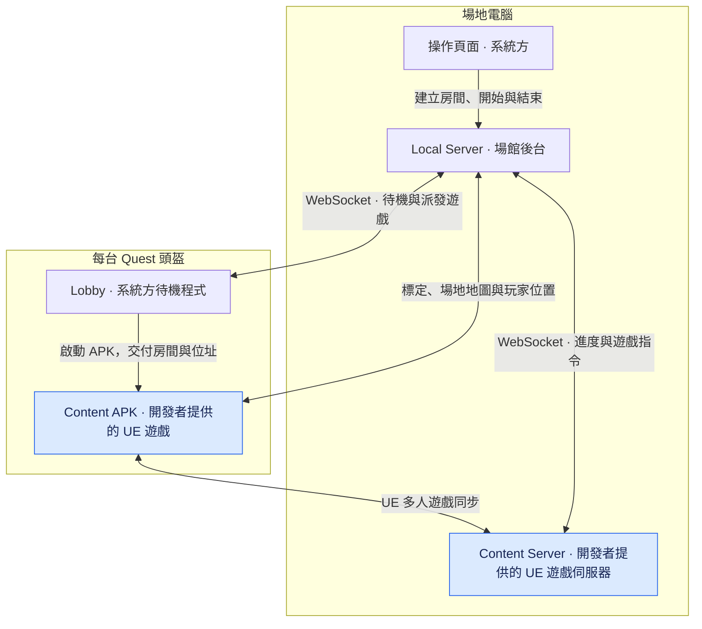

**頭盔上的 Content 會連到兩個服務。** 即使服務跑在同一台電腦，也要依用途把位址交給正確的藍圖節點。

| 要做的事 | 連到哪裡 | Content 怎麼連 |
|---|---|---|
| 取得地圖、標定與房間事件 | Local Server，WebSocket 預設 5000 | `StartSystem` 填入 `-wsserverip` 和 `-wsport`。插件另以 UDP 7000 上傳頭盔位置 |
| 加入同一場 UE 多人遊戲 | Content Server，遊戲連線預設 UDP 7777 | 讀取含連接埠的 `-serverip`，執行 `open <serverip>` |

**場地怎麼對齊？** 每個 ArUco marker 都有編號，系統方事先量好它的位置並存成場地地圖。遊戲帶入地圖代號（`MapName`），插件自動下載地圖和相機標定檔。玩家正對牆面 marker 站穩後，頭盔相機辨識標記，插件算出玩家在場地中的位置與朝向。以下首次定位範例採用這個 ArUco 流程。

### 一場遊戲怎麼開始與結束

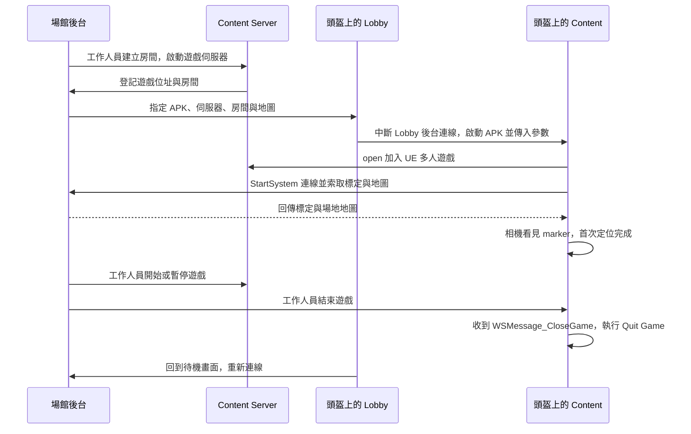

## 執行時程式與功能

同一個 UE 專案會在頭盔和遊戲伺服器執行。接 Blueprint 時，先看功能發生在哪一端，再選該端的 Pawn 或 GameMode。

| 現場發生什麼事 | 正在執行的程式 | 哪段程式負責 | 開發者要接的功能 |
|---|---|---|---|
| 操作員選房間、地圖和頭盔 | 操作頁面 → Local Server | 後台啟動 Content Server，通知 Lobby | 提供 APK 的 package name 和 Server 啟動地圖 |
| 頭盔從待機畫面進入遊戲 | Lobby → Content APK | Lobby 用 Android Intent 帶入命令列，Content 的 Pawn 在 BeginPlay 讀取參數 | 讀取 `serverip`，在單機關卡用 `open` 加入伺服器 |
| 虛擬場景對齊場地 | Content APK | `MultiVRGIS.StartSystem` 取得地圖與標定；`MultiVR Component` 將定位結果套用到 Pawn | 先綁 `OnSystemReady`，首次定位完成後顯示就緒畫面 |
| 玩家走近彼此 | Content APK ↔ Local Server | 插件上傳位置，後台分送附近玩家資料 | 在 Pawn 接 `OnDetectNearbyUsers`，依玩家 ID、位置與朝向更新角色 |
| 操作員開始或暫停遊戲 | Local Server → Content Server | Dedicated Server 的 GameMode 透過 `StartConnectWebSocket` 接收指令 | 接 `OnWebAction_StartGame`／`OnWebAction_PauseGame`，以 `WSSend_GameStatus` 回報狀態 |
| 場館發出或解除警報 | Local Server → Content APK | 插件接收警報並自動回覆確認 | 接 `OnEmergencyAlert` 顯示指示，接 `OnEmergencyClear` 清除畫面 |
| 工作人員結束遊戲 | Local Server → Content APK → Lobby | Content 收到關閉指令，Lobby 在 Content 結束後回到前景 | 在 `WSMessage_CloseGame` 執行 `Quit Game` |

## 環境需求

| 項目 | 需求 |
|------|------|
| Unreal Engine | **原始碼版** UE 5.3.2 或 UE 5.8.4（不支援 Epic Launcher 版）。交付包分版本提供，請使用與引擎相同版本的包 |
| 引擎 BuildId | 引擎的 `Engine\Build\Build.version` 必須加上交付包指定的 BuildId（見[安裝步驟](#安裝步驟)） |
| 專案 | **C++ 專案**（純藍圖專案先在編輯器 `Tools → New C++ Class` 隨便加一個 class 就會變成 C++ 專案）；打包 content server 需要 Server Target（`<專案>Server.Target.cs`，見安裝步驟 4） |
| 目標平台 | Android（arm64-v8a）為主，Win64 可在編輯器內開發；content server 只支援 Win64 |
| HMD | Meta Quest 3 / 3S / Quest Pro；HTC 裝置走 LBS 模式（`IsHTCLBS`） |
| 相依插件 | **Meta XR 插件（`OculusXR`）必須放在專案的 `Plugins` 並啟用**（與引擎版本對應的版本）；`AndroidPermission` 由 MultiVR 自動啟用 |
| Android | SDK、JDK 17；NDK 版本依引擎：**UE 5.3.2 用 r25b、UE 5.8.4 用 r27c** |

---

## 安裝步驟

> **使用 AI Agent 協助安裝**
>
> 插件交付包內附 `Plugins/MultiVR/AGENT_INSTALL.md`。使用 AI Agent 協作的開發者，可將這份文件交給 Agent，並提供目標 UE 專案與引擎的路徑，請 Agent 依該版本的指引協助安裝插件及設定專案。

### 安裝流程一覽

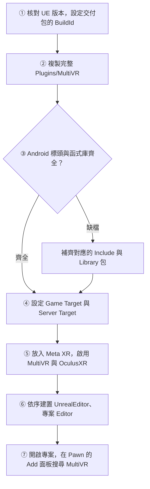

圖中的編號對應下方七個操作步驟。完整 zip 若已包含 Android 相依檔，核對完第 3 步即可繼續。

開始前，向系統方確認交付包版本與 BuildId。上頭盔測試前，另備妥可連線的後台 IP、連接埠、測試房間代號、場地地圖代號，以及與地圖相符的牆面 marker。

1. **設定引擎 BuildId**
   打開 `<引擎>\Engine\Build\Build.version`，在最後一個欄位後面加上一行（前一行要補逗號）：

   ```json
   {
   	"MajorVersion": 5,
   	...（原本的欄位不動）...
   	"BranchName": "++UE5+Release-5.x",
   	"BuildId": "<交付包 README 內的 BuildId>"
   }
   ```

   每台要開這個專案的電腦都要做。插件只能在 BuildId 相同的引擎上載入，沒設定的話開專案會出現「模組遺失」並要求重新編譯。

2. **放入外掛**
   把交付包裡整個 `Plugins/MultiVR` 資料夾複製到 `<專案>\Plugins\MultiVR`。已有舊版時，先整個刪除再放入，不要混用新舊檔案。

3. **補上 markerless 相依檔（依交付包內容）**
   RTAB-Map / PCL / Boost 的標頭與函式庫太大（約 3.2 GB），若交付包缺少下列檔案，請另外下載。**沒補上的話 Android 打包會失敗**。

   1. 下載 Include 包：https://drive.google.com/file/d/1QTqyZEEMALUr-rLC0KLCdpFL1AuSgw1J/view?usp=sharing
      解壓到 `<專案>\Plugins\MultiVR\Include\Android\include`
   2. 下載 Library 包：https://drive.google.com/file/d/1sBz7Is1bqi5pGB7Mha1HX-KHheI1jMv8/view?usp=sharing
      解壓到 `<專案>\Plugins\MultiVR\Library\Android\libs` 並覆蓋

   完成後應該有 `Include\Android\include\rtabmap`、`pcl`、`boost` 三個資料夾，以及 `Library\Android\libs\arm64-v8a\librtabmap_core.a`。
   （若拿到的是系統方直接給的完整 zip，裡面已經包含，這步可略過。）

4. **修改 Target**
   在專案的 Game Target（`<專案>.Target.cs`）與 Server Target（`<專案>Server.Target.cs`）建構式內都加上：

   ```csharp
   BuildEnvironment = TargetBuildEnvironment.Shared;
   ```

   沒加的話，打包 APK 或 content server 時會出現 `Missing precompiled manifest`。

   專案還沒有 Server Target 時，複製 `Source\<專案>.Target.cs` 成 `Source\<專案>Server.Target.cs`，把裡面的 class 名稱改成 `<專案>ServerTarget`、`Type = TargetType.Game` 改成 `Type = TargetType.Server`。

5. **在 `.uproject` 啟用插件**（`MultiVR` 與 `OculusXR` 都**必須**啟用，沒啟用 OculusXR 會建置失敗）：

   ```json
   "Plugins": [
   	{ "Name": "MultiVR", "Enabled": true },
   	{ "Name": "OculusXR", "Enabled": true }
   ]
   ```

   Meta XR 插件本身要另外放進 `<專案>\Plugins\MetaXR`（使用與引擎版本對應的版本）。

6. **建置一次編輯器**
   依序執行（先引擎、再專案；只建專案的話，引擎的 BuildId 不會更新）：

   ```
   <引擎>\Engine\Build\BatchFiles\Build.bat UnrealEditor Win64 Development -WaitMutex
   <引擎>\Engine\Build\BatchFiles\Build.bat <專案>Editor Win64 Development -Project="<專案>.uproject" -WaitMutex
   ```

   第一行通常只會更新清單檔，約數十秒。完成後 `<引擎>\Engine\Binaries\Win64\UnrealEditor.modules` 的 BuildId 應該等於交付包的值。

7. **開啟專案**，確認沒有出現「模組遺失或由不同引擎版本建置」的對話框。

### 不要做的事

- **不要刪除 `Plugins\MultiVR\Intermediate` 和 `Plugins\MultiVR\Binaries`**：插件打包要用到裡面的檔案，刪了就無法打包。清理專案時只刪專案自己的 `Intermediate`、`Binaries`。
- 不要對 MultiVR 執行 Rebuild，也不要在出現「是否重新編譯 MultiVR」時按「是」：插件是建置好的，重新編譯一定失敗。出現這個對話框代表 BuildId 沒設對，回頭檢查步驟 1 和步驟 6。
- 不要手動修改 `Plugins\MultiVR\Binaries\Win64\UnrealEditor.modules`。
- 不要用其他來源的 OpenCV / RTAB-Map / PCL / Boost 替換 `Include` / `Library`：只用交付包內附的檔案與上面兩個下載包，版本不符會連結錯誤或閃退。

---

## 目錄結構

```
Plugins/MultiVR/
├─ MultiVR.uplugin
├─ README.md                      本版本的安裝說明（含 BuildId）
├─ AGENT_INSTALL.md               供 AI Agent 協助安裝插件與設定 UE 專案的指引
├─ Binaries/ , Intermediate/      建置好的插件檔案（不可刪、不可改）
├─ Content/                       插件附帶的素材與編輯器工具（Galaxy 素材庫）
├─ Include/ , Library/            插件需要的函式庫（RTAB-Map / PCL / Boost 依包內檔案確認，見安裝步驟 3）
└─ Source/                        給專案引用的標頭檔（不需要修改）
```

整個資料夾照原樣放進專案即可，裡面的檔案都不需要手動修改。

開發者在 Blueprint 中會用到以下兩個插件入口：

| 名稱 | 在哪裡用 | 負責 |
|------|----------|------|
| **Multi VRGIS** | 任何藍圖搜尋「Multi VRGIS」取得 | 連線後台、定位、收發訊息、效能設定，所有函式與事件都在這裡 |
| **MultiVR Component** | 加在玩家 Pawn 上 | 把定位結果套用到玩家位置，並自動處理靠牆透視、眼動 / 表情追蹤 |

---

## 範例專案對照

若已從系統方取得 UE 5.8 的 **example 專案**，在 Unreal Editor 的 Content Browser 搜尋下列資產名稱，開啟 Blueprint 對照自己的專案。建議照實際整合進度分三次看。

| 什麼時候看 | 打開哪個 Blueprint | 看哪一段、怎麼用 |
|---|---|---|
| 插件已載入，要讓第一台頭盔定位時 | `BP_XRPawn` | 看 Components 面板與 Event Graph。對照自己的玩家 Pawn，先接就緒事件，再呼叫 `StartSystem` |
| 單台定位成功，要讓 Lobby 啟動多人遊戲時 | `BFL_GetArg`、`BP_XRPawn` | 看函式如何取出命令列參數，再看 Pawn 如何分流到 `open` 或 `StartSystem`。測試時改用自己的房間、地圖與連線位址 |
| 打包 Win64 Server、準備測開始與暫停時 | `BP_XRGameMode` | 看 Dedicated Server 判斷、事件綁定及 `StartConnectWebSocket`，對照自己的 GameMode 回報進度與狀態的時機 |

若尚未取得範例，可直接跟著下一節的流程圖與節點截圖接線。

## 快速開始

先用單台 Quest 驗證 ArUco 定位。先在編輯器接好 Blueprint，再打包到頭盔驗證。下圖以上下兩段標出設定與執行的時機。

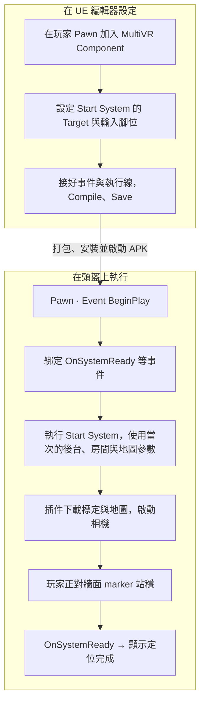

### 1. 在 VR Pawn 上加入元件

打開玩家的 VR Pawn 藍圖（含 Camera 元件的 Pawn，例如 VR Template 的 `VRPawn`）→ 左上 **Components** 面板按 **Add** → 搜尋「MultiVR」→ 選 **MultiVR Component** → Compile、Save。
不需要設定任何屬性：元件會在第一次定位成功時自動抓取 Camera，並把 Pawn 設為 Aruco 中心 Actor。

> 確認這個 Pawn 就是遊戲實際會生成的 Pawn（GameMode 的 `Default Pawn Class`，或關卡中設為 `Auto Possess Player = Player 0` 的 Pawn）。

| 在 Components 面板新增元件 | 在 Event Graph 取得插件入口 |
|---|---|
|  | 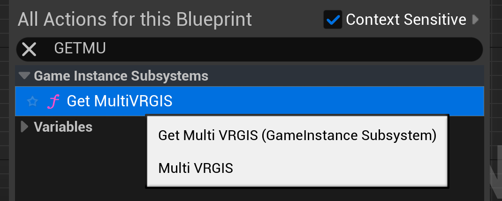 |
| 加到實際生成的玩家 Pawn。 | 取出的 MultiVRGIS 接到事件與函式的 Target。 |

### 2. 設定 Start System 節點

在 Pawn 的 Event Graph 放入 `Get MultiVRGIS`，從輸出腳位拉出 **Start System**。先設定下圖的輸入腳位，執行線在下一步接上。


單台頭盔測試可直接填入場館的後台 IP、Port、房間與地圖代號，並省略 UE 遊戲伺服器的 `-serverip`。正式多人開場時，在編輯器把這些腳位接到變數；遊戲啟動後從 Lobby 傳入的命令列取得當次的值，再執行節點。

```
StartSystem(
    IP        = "192.168.9.223",   // 後台電腦的 IP（正式流程由 Lobby 傳入 -wsserverip）
    Port      = "5000",            // 後台的 port（-wsport）
    ClientId  = "",                // 留空：自動用頭盔的 Wi-Fi IP 當頭盔 ID（建議一律留空）
    MapName   = "MapCodeName",     // 場地地圖的代號，要跟後台存的一樣（-mapName）
    RoomID    = "1234",            // 房間代號（-roomId）
    IsHTCLBS  = false,             // Quest 一律 false；true 只用於 HTC LBS 裝置
    SlamType  = ARUCO,             // 用 marker 定位填 ARUCO（MARKLESS / MIX 為無 marker 定位）
    HMDType   = "quest3s"          // 目前不使用（標定檔固定以 quest3s 向後台索取），填 "quest3s" 即可
)
```

### 3. 接好事件與啟動執行線

在玩家 Pawn 的 BeginPlay、**呼叫 `StartSystem` 之前**綁定。藍圖做法：`Get MultiVRGIS` 拉出線 → 搜尋 **Bind Event to On System Ready** → 從節點左邊紅色的 `Event` 腳位拉出 → `Add Custom Event`，由開發者在 Custom Event 後接上定位完成時要執行的遊戲邏輯。其他事件做法相同。

**接線時對照**：下圖由左到右是首次定位、附近玩家事件，以及拆開一筆玩家資料的節點。

| 首次定位完成 | 收到附近玩家 | 讀取一筆玩家資料 |
|---|---|---|
|  | 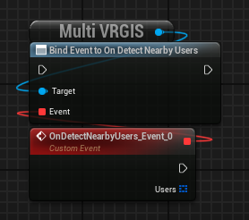 |  |
| 接自訂事件顯示就緒畫面。 | 遍歷 Users 陣列。 | 用 Clientid 找角色，用 Position 與 Rotation 更新姿態。 |

至少綁定以下事件：

| 事件 | 什麼時候發生 | 開發者的處理方式 |
|------|--------------|----------------|
| `OnSystemReady` | 首次定位完成 | 顯示開始畫面、允許玩家開始遊戲 |
| `OnDetectNearbyUsers` | 收到其他玩家的位置（持續觸發） | 用 `Clientid` 生成 / 移動其他玩家的角色 |
| `WSMessage_CloseGame` | 工作人員結束遊戲 | `Quit Game`，頭盔會回到 Lobby |
| `OnEmergencyAlert` / `OnEmergencyClear` | 工作人員發出 / 解除緊急警報 | 顯示 / 清除警報畫面（見[緊急警報 UI 建議](#緊急警報-ui-建議)） |
| `OnCameraBlock` | 頭盔相機被遮住 | 提示玩家不要遮住頭盔前方 |

在 Event Graph 將白色執行線依序接成 **Event BeginPlay → Bind Event 節點 → Start System**。將 `OnSystemReady` 對應的 Custom Event 接到「定位完成」畫面提示，再 Compile、Save。

#### 在頭盔上啟動與驗證

呼叫之後插件會自動做完以下所有事，不需要另外寫程式：連上後台 → 下載相機標定檔 → 下載地圖 → 打開相機開始定位 → 首次定位完成後發出 `OnSystemReady`。

> **定位只能在頭盔上測試**：在編輯器（PIE）或 Win64 執行時，插件仍會連後台、下載地圖，但不會開相機，所以**不會有 `OnSystemReady`**。編輯器裡適合測連線與畫面，定位請打包 APK 上頭盔測。

**上機驗證**：依[打包步驟](#android-打包注意事項)安裝 APK，在測試房間啟動遊戲。戴好頭盔正對牆面 marker 站穩 1～2 秒。畫面出現「定位完成」即代表收到 `OnSystemReady`。若只看到連線成功，仍需等首次定位事件；可用 [Log 說明](#log-說明) 的 `[first-init]` 查看卡在哪個條件。

<a id="multiplayer"></a>

### 4. Lobby → Content 流程（多人遊戲）

正式開場時，Lobby 會帶入遊戲伺服器位址。下圖是 **Content 的 Pawn 藍圖**：第一次 BeginPlay 負責加入多人關卡；進入該關卡後，新 Pawn 的 BeginPlay 再啟動定位。

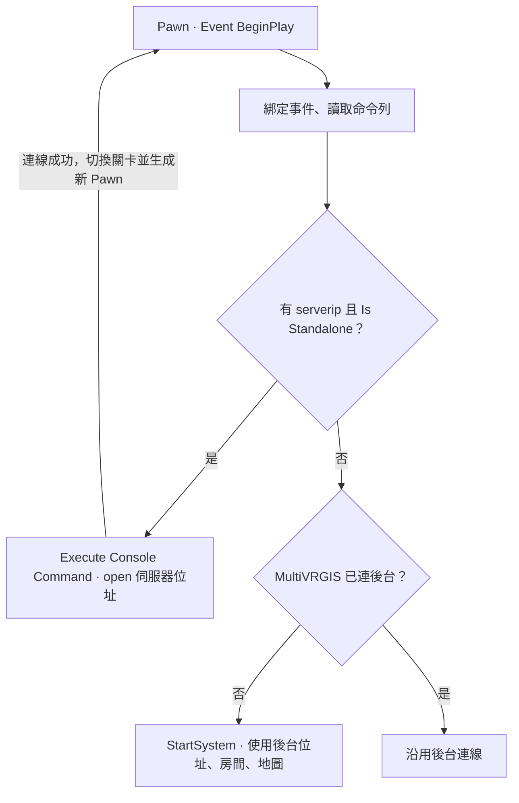

1. 後台開始遊戲時，Lobby 收到 `headset_game_backend_command`（`command=connect`）：

   ```json
   {
     "type": "headset_game_backend_command",
     "command": "connect",
     "connectData": {
       "roomId": "room1",
       "ip": "192.168.9.102",
       "port": 7777,
       "packageName": "com.YourCompany.example",
       "mapName": "tt"
     }
   }
   ```

   Lobby 關閉自己的 WebSocket（讓出共用的 `clientId`），約 3 秒後用 Android Intent 啟動 `packageName` 指定的 Content APK，把參數組成 UE 命令列放進 Intent extra **`cmdline`**（必須全小寫）。效果等同下面這行 adb 指令：

   ```bat
   adb shell "am start -S -n com.YourCompany.example/com.epicgames.unreal.GameActivity --es cmdline '-wsserverip=192.168.9.102 -wsport=5000 -mapName=tt -roomId=room1 -serverip=192.168.9.102:7777'"
   ```

   | 參數 | 來源 | 用途 |
   |------|------|------|
   | `-serverip` | `connectData.ip` + `port` | content server 位址，Content 用 `open` 連進去 |
   | `-wsserverip` / `-wsport` | Lobby 連的後台位址 | `StartSystem` 的 IP / Port |
   | `-roomId` | `connectData.roomId` | `StartSystem` 的 RoomID |
   | `-mapName` | `connectData.mapName` | `StartSystem` 的 MapName（Aruco 地圖代號） |

   > **不經過 Lobby 測試**：content server 跑起來後，直接用上面的 adb 指令（換成自己的 package、IP、房間、地圖）就能模擬 Lobby 啟動遊戲。`-S` 會先關掉已在執行的 App 再重開。

2. **Content 啟動後由專案自行讀取這些參數**（插件不會自動解析）：Blueprint 用 `Get Command Line` → `Parse Command Line` 拆成 Key/Value（輸出的 `Params` Map），再用 `Find` 以 Key 找值；**Key 不含減號**，例如找 `serverip` 而不是 `-serverip`（C++ 可用 `FParse::Value(FCommandLine::Get(), TEXT("serverip="), Out)`）。沒帶參數時用預設值，方便單機測試。
3. **Pawn 的 BeginPlay**（每次進關卡都會跑）：先綁定 MultiVR 事件（`OnSystemReady`、`WSMessage_CloseGame` 等），再依情況二選一：
   - **有帶 `-serverip`，而且目前是單機（`Is Standalone`）** → 執行 Console Command `open <serverip>`，連進 content server。
   - **否則，如果插件還沒連線（`IsConnected()` = false）** → 呼叫 `StartSystem`：
     - `IP` / `Port` = `-wsserverip` / `-wsport`
     - `RoomID` = `-roomId`
     - `MapName` = `-mapName`
     - **`ClientId` 留空**：插件會用裝置 IPv4，與 Lobby 使用的身分相同，後台才對得上同一台頭盔。
4. `open` 會換關卡，**Pawn 重生、BeginPlay 再跑一次**。這時已經是 client（不是單機），所以改走 `StartSystem`。
   - 事件每次都要重新綁定；`StartSystem` 只會在第一次（`IsConnected()` = false）時呼叫。
   - 沒帶 `-serverip`（單機測試）時第一次就直接 `StartSystem`，留在目前關卡。
5. 插件自動完成標定、地圖、首次定位 → **`OnSystemReady`**，遊戲可以開始。
6. 插件會自動回報 content server 連線狀態（`headset_status.contentServer`）：
   - 進入 content server 的關卡 → `connected`
   - 連不上 → `failed`（附錯誤原因）
   - 連上後斷線，或回到單機關卡 → `disconnected`
7. 後台結束遊戲時，Content 收到 `headset_game_backend_command`（`command=disconnect`），插件自動回覆 `game_close` 並廣播 **`WSMessage_CloseGame`**。**請在這裡結束 App（`Quit Game`）**，Lobby 會回到前景並重新連線後台。

> Lobby 與 Content 在同一台頭盔共用同一個 IPv4 作為 `clientId`，同一時間只能有一方連著後台；Lobby 會在啟動 Content 前先斷線，Content 結束後再重連。Lobby 的細節（安裝、watchdog、kiosk 設定）見 Lobby 專案的 README。
>
> `WSMessage_StartGame` 是舊流程（Lobby 也用本插件時）使用的事件，目前的 Lobby App 架構下 Content 不需要綁定。

#### Content Server 的 GameMode

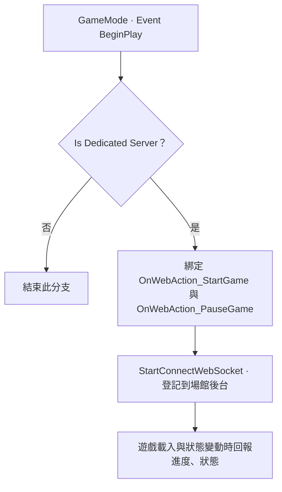


| 先綁定操作頁面的開始事件 | 再登記伺服器連線 |
|---|---|
| 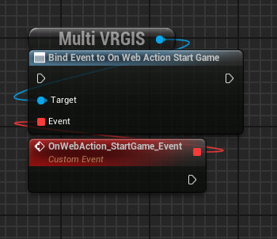 | 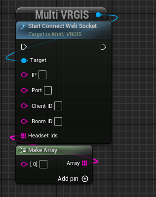 |
| 暫停事件用相同方式綁定 `OnWebAction_PauseGame`。 | 將命令列的房間代號與頭盔清單傳給後台。 |

- 啟動範例：`exampleServer.exe /Game/<地圖> -port=7777 -ip=<本機區網 IP> -wsserverip=<後台 IP> -wsport=5000 -roomId=<房間> -headsetIds=<逗號分隔>`。地圖要放第一個參數，否則會載入空的預設地圖。
- **`-ip` 不能空**：後台收到空 ip 會忽略這台 content server，房間綁不上，開始 / 暫停都沒反應。
- GameMode 的 BeginPlay（先用 `Is Dedicated Server` 接 Branch，只有 true 才往下做，避免頭盔或編輯器單機時也跑）：綁定事件後呼叫 `StartConnectWebSocket`（IP / Port / RoomID / HeadsetIds 由命令列帶入，`ClientID` 留空）。插件以 `game_backend` 身分連線，並把 ip / port 回報給後台。
- **房間要先建立，content server 才能啟動**。
- 用 `WSSend_Progress` 回報載入進度、`WSSend_GameStatus` 回報遊戲狀態。
- 綁定 `OnWebAction_StartGame` / `OnWebAction_PauseGame` 接收後台的開始 / 暫停。
- 後台送 `close_content_server` 時插件會直接結束程式。

### 5.（選用）效能設定

需要省 CPU 或調整 log 時，呼叫 `ApplyPerfSettings`，見[效能設定](#效能設定)。不呼叫則維持預設行為。

---

## Android 打包注意事項

### 打包步驟

**頭盔 APK**

1. `Edit → Project Settings → Platforms → Android`：
   - 按 **Configure Now** 接受 SDK 授權；
   - 填 **Android Package Name**（例如 `com.YourCompany.example`）。**這個名稱要告訴系統方**，後台要用它讓 Lobby 啟動開發者交付的遊戲 APK（`connectData.packageName`）；
   - Package for Meta Quest devices 勾選；Build 只勾 arm64。
2. `Edit → Project Settings → Platforms → Android SDK`：填 SDK、NDK（版本見下方）、JDK 17 路徑。
3. Meta XR 建議設定可用 Meta XR 插件的 **Project Setup Tool**（工具列 Meta XR 選單）一鍵套用。
4. 工具列 `Platforms → Android → Package Project`，選輸出資料夾。完成後用資料夾內的 `Install_*.bat` 或 `adb install -r <apk>` 裝到頭盔。

**Content Server（Win64）**

1. 確認已有 `<專案>Server.Target.cs`（安裝步驟 4），並跑過一次步驟 6 的編輯器建置。
2. 工具列 `Platforms → Windows`：**Build Target** 選 `<專案>Server` → `Package Project`。
3. 輸出資料夾裡的 `<專案>Server.exe` 交給系統方，由後台啟動（啟動參數見 [Content Server 端](#multiplayer)）。

### 插件自動處理的部分

打包時插件會自動加入以下設定，**不需要手動加**：

- Android 權限：`CAMERA`、`horizonos.permission.HEADSET_CAMERA`、`RECORD_AUDIO`、`MANAGE_EXTERNAL_STORAGE`
- 頭盔相機存取與 WebRTC 串流需要的函式庫

其他：

- 只支援 **arm64-v8a**，Texture 格式建議 ASTC。
- NDK 版本依引擎：UE 5.3.2 用 r25b、UE 5.8.4 用 r27c。
- 執行期會先請求 Android 權限，權限未過前連線會先擱置，取得後自動續連。
- 標定檔與地圖檔每次啟動時由插件自動從後台下載，不需要放進專案。
- 若用 `-CookAll` 打包，可在 `DefaultGame.ini` 的 `[/Script/UnrealEd.ProjectPackagingSettings]` 加入 `+DirectoriesToNeverCook=(Path="/MultiVR/EUW")`，排除編輯器工具 Widget。

---

## 場地驗收

交付頭盔 APK、Android package name、Win64 Server 打包目錄及伺服器啟動地圖。與系統方用同一房間、兩台頭盔依序走一次下表。

| 現場操作 | 成功時看得到什麼 | 若卡住，先查 |
|---|---|---|
| 建立房間並選擇兩台頭盔 | Content Server 啟動，兩台 Lobby 各自開啟指定 APK | Server 的地圖與區網 IP、APK 的 package name |
| 等待玩家進入多人關卡 | 後台收到兩台頭盔的 `contentServer = connected` | `-serverip` 是否包含遊戲連接埠、UDP 7777 是否可達 |
| 讓兩位玩家各自面向牆面 marker 站穩 | 兩端都觸發 `OnSystemReady`，場景方向與實體場地一致 | `MapName`、標定檔與 `[first-init]` log |
| 讓兩位玩家靠近並移動 | `OnDetectNearbyUsers` 回傳對方位置，遊戲的角色或提示跟著移動 | 事件綁定、房間代號與 UDP 7000 |
| 從操作頁面開始、暫停，再結束遊戲 | Server 收到開始與暫停事件，兩台 Content 結束後回到 Lobby | GameMode 的事件綁定、Pawn 的 `WSMessage_CloseGame → Quit Game` |

---

## API 參考

### Multi VRGIS

#### 連線

| 函式 | 說明 |
|------|------|
| `StartSystem(IP, Port, ClientId, MapName, RoomID, IsHTCLBS, SlamType, HMDType)` | 一鍵啟動：設定 SLAM 類型 + 連線 WebSocket |
| `StartConnectWebSocket(IP, Port, ClientID, RoomID, HeadsetIds)` | 只建立主連線 |
| `StartConnectMultiWebSocket(IP, ServerPort, ClientID, RoomID, IsGameServer)` | 建立多條連線（後台 / 多頭盔測試用），存於 `WebSockets` 陣列 |
| `WebSocketSend(Text)` / `CloseWebSocket()` / `CloseAllWebSockets()` / `IsConnected()` | 基本收送與關閉 |
| `GetRoomID()` / `GetClientID()` / `GetIsHTCLBS()` / `SetIsHTCLBS(bool)` | 狀態查詢與設定 |
| `GetHeadsetIDBySN(SN)` | 以頭盔序號查詢 HeadsetID |

斷線時會自動重試，重連成功走 `WSOnReConnected`。

#### 資料傳送

| 函式 | 送出 type | 用途 |
|------|-----------|------|
| `WSSend_HeadSetData(Position, Rotation)` | `transform_update` | 頭盔位置/朝向（**經 UDP 7000 送出**，單位由 cm 轉為 m） |
| `WSSend_HeadSetDataToIndex(SocketIndex, HeadsetID, Pos, Rot)` | `transform_update` | 指定第 N 條 WebSocket 送出（多頭盔模擬） |
| `WSSend_Progress(Percent)` | `game_progress` | 遊戲載入進度（GameServer） |
| `WSSend_GameStatus(EGameStatus)` | `game_status` | `GAME_IDLE / GAME_PLAYING / GAME_END / GAME_PAUSE` |
| `SendEmergencyAlertAck(AlertId)` | `emergency_alert_ack` | 收到警報時已自動回覆，必要時可手動再送 |

#### SLAM / 相機

| 函式 | 說明 |
|------|------|
| `ActiveCamera()` | 開啟頭盔透視相機 |
| `InitSlam_Aruco(ArucoSize, MaxDetectLength)` | 初始化 Aruco SLAM（系統自動呼叫，預設 0.40 m / 4 m；marker 尺寸實際以地圖檔為準） |
| `SetOutlierFilterParam(RejectDistCm, ConfirmCount, HistoryLen)` | 水平離群過濾參數（預設 100 cm / 3 次） |
| `SetOutlierFilterParamZ(RejectDistZCm)` | 高度離群過濾門檻（預設 30 cm） |
| `GetCameraTexture()` / `GetCameraData(W,H)` / `UpdateCameraTexture()` | 取得相機畫面 Texture2D（640×480 BGRA），可做除錯顯示 |
| `SetBaseOffsetInMeters()` / `SetBaseRotationInMeters()` | 調整 XR 基準位移與旋轉 |
| `GetZoneState(Pos)` | 回傳位置相對危險區（牆、柱）的狀態：`Safe` / `Warning` / `Danger` |

#### 效能

| 函式 | 說明 |
|------|------|
| `ApplyPerfSettings(bSlamPaused, SlamInterval, PluginLogLevel, UploadHz, RemoteHz)` | 一次設定全部效能參數，見[效能設定](#效能設定) |
| `GetPerfSettings(...)` | 讀回目前設定與網路狀態（往返延遲、伺服器停留時間、每秒收送筆數） |

#### WebRTC 串流

`ConnectWebRTC()`（送 `stream_request`）、`CloseWebRTC()` / `EndWebRTC()`（送 `stream_end`）、`CallOffer()`、`WebRTC_SendOffer/Answer/IceCandidate(...)`。

#### JSON 工具（皆為 BlueprintCallable）

`GetStringValue`、`GetNumberValue`、`GetBoolValue`、`GetJsonStringValue`、`GetJsonStringArrayValue`、`GetStringArrayValue`、`GetNumberArrayValue`、`GetFloatArrayValue`。
可直接在 Blueprint 解析 `WSOnMessage` 收到的原始字串。

### MultiVR Component

| 成員 | 說明 |
|------|------|
| `SetDetectInfo(DetectCD, InterpSpeed)` | 定位冷卻秒數（預設 0.5 秒）與位置插值速度（Android 預設 25，並依修正距離自動調整） |
| `SetPillarFlashParam(MinDistCm, CooldownSec)` | 柱子重定位閃爍條件：修正距離門檻（預設 100 cm）與冷卻（預設 3 秒） |
| `OnRelocalizeFlash`（BlueprintImplementableEvent） | 場景「直接拉過去」時觸發，接閃爍過場 Blueprint |
| `SetAutoZonePassthrough(bEnable)` | 開關「靠近危險區自動開透視」（預設開）。關閉時透明度回到 `SetMetaPassthroughOpacity` 設定的值 |
| `SetMetaPassthroughOpacity(Opacity)` | 手動設定 Passthrough 基礎透明度（0 = 關閉透視、1 = 全透視） |

---

<a id="events"></a>

## 事件（Event Dispatcher）

### 通用

| 事件 | 參數 | 觸發時機 |
|------|------|----------|
| `WSOnConnected` | — | WebSocket 連線成功 |
| `WSOnReConnected` | — | 斷線後重連成功 |
| `WSOnConnectClose` | — | 連線關閉 |
| `WSOnConnectError` | `Message` | 連線錯誤（會自動重試） |
| `WSOnMessage` | `Message` | 收到任何原始訊息（除錯 / 自訂協定用） |
| `WSMessage_CloseGame` | — | 後台要求關閉遊戲 |

### Lobby（頭盔端）

| 事件 | 參數 |
|------|------|
| `WSMessage_StartGame` | `roomid, execPath, ip, port`：舊流程用（Lobby 也使用本插件時）。目前 Lobby 是獨立 App，Content 改由命令列取得參數，見 [Lobby → Content 流程](#multiplayer) |

### Content（頭盔端）

| 事件 | 參數 | 說明 |
|------|------|------|
| `OnSystemReady` | — | 首次定位完成、UDP 啟動，可開始遊戲 |
| `OnDetectNearbyUsers` | `TArray<FUser>` | 鄰近玩家（`Clientid` / `Position` / `Rotation` / `IsSameRoom`），已換算到 Aruco 中心座標系 |
| `OnCameraBlock` | — | 相機被遮蔽（SLAM 回傳 `block`） |
| `OnHMDLanguageSet` | `Language` | 後台下發語系 |
| `OnTemperatureGet` | `Temperature` | 場館氣溫 |
| `OnEmergencyAlert` | `FEmergencyAlertData` | 緊急警報（`AlertId` / `Level` / `Cause` / `Instruction` / `Timestamp`），已自動回 ack |
| `OnEmergencyClear` | `FEmergencyClearData` | 解除警報（`AlertId` / `ResumedRooms` / `Timestamp`），UI 應清除所有警報 |
| `OnUpdateEyeTracking` | `GazeData, StereoGazeData, IsSuccess` | Meta 眼動 |
| `OnUpdateFaceTracking` | `FaceState, IsSuccess` | Meta 表情（70 組 blendshape 權重） |

`EEmergencyLevel`：`NOTICE / WARNING / CRITICAL`
`EEmergencyCause`：`CUSTOM / FIRE / EARTHQUAKE / EVACUATION`

| 發出警報 | 解除警報 |
|---|---|
|  |  |
| 從 Alert Data 取出 Level 與 Instruction。 | 收到事件時清除警報 UI。 |

#### 緊急警報 UI 建議

| Level | 建議 UI |
|-------|---------|
| `CRITICAL` | 全螢幕強制遮罩 + 音效，玩家無法關閉 |
| `WARNING` | 警告 UI 覆蓋，遊戲暫停 |
| `NOTICE` | 角落通知，不中斷遊戲 |

- 顯示文字一律用 `Instruction`（後台已組好、含多語系），`Cause` 只用來決定圖示或音效。
- 收到 `OnEmergencyClear` 時**一律清除所有警報 UI**，`AlertId` 可能是空字串（強制清除），不需判斷。
- ack 已內建（收到 `emergency_alert` 立即回 `emergency_alert_ack`），content 不用處理。

```
[BeginPlay]
   Get MultiVRGIS
     ├─ Bind Event to On Emergency Alert → Switch on Level → 顯示對應 UI，Set Text ← Instruction
     └─ Bind Event to On Emergency Clear → 移除所有警報 UI
```

### GameServer（Dedicated Server）

| 事件 | 說明 |
|------|------|
| `OnWebAction_StartGame` | 後台按下「開始遊戲」 |
| `OnWebAction_PauseGame` | 後台按下「暫停遊戲」 |

---

## 通訊協定

### 送出（Client → Server）

| type | 觸發 |
|------|------|
| `transform_update` | `WSSend_HeadSetData`（UDP 7000）／`WSSend_HeadSetDataToIndex` |
| `game_progress` / `game_status` | `WSSend_Progress` / `WSSend_GameStatus` |
| `emergency_alert_ack` | 收到 `emergency_alert` 時自動送出 |
| `get_calibration` | 收到 `init_player_info` 後自動索取相機標定（帶 `deviceType` / `mapType`） |
| `get_map` | 標定取得後自動索取 Aruco 地圖（帶 `codeName`） |
| `game_close` | 收到 `headset_game_backend_command: disconnect` 時自動回覆 |
| `headset_tracking_update` | 首次定位完成、或 `resync_pose` 重新定位完成時回報 tracking 狀態 |
| `headset_status`（`arucoVisible` / `arucoAvgVisible`） | 每秒回報目前看到幾顆 marker 與過去 1 秒平均，供後台監看定位狀況 |
| `headset_status`（`contentServer` / `contentServerError`） | 頭盔與 content server 的連線狀態變化時回報：`connecting` / `connected` / `disconnected`（連上後斷線）/ `failed`（一開始就連不上）；後台連線或重連後也會補送一次 |
| `stream_request` / `stream_end` | WebRTC 串流開始 / 結束 |
| `signal_offer` / `signal_ice_candidate` / `headset_msg` | WebRTC 信令 |

### 接收（Server → Client）

| type | 處理 |
|------|------|
| `proximity_update` | 解析鄰近玩家 → `OnDetectNearbyUsers`（WebSocket 與 UDP 兩條路徑皆支援） |
| `headset_game_backend_command` | `command=connect` → `WSMessage_StartGame`；`command=disconnect` → 回 `game_close` + `WSMessage_CloseGame` |
| `start_game` / `pause_game` | → `OnWebAction_StartGame` / `OnWebAction_PauseGame` |
| `close_content_server` | 直接 `RequestExit` 並廣播 `WSMessage_CloseGame` |
| `init_player_info` | 取語系、氣溫；HTC LBS 直接就緒，否則進入標定流程 |
| `get_calibration_ack` | 存檔左眼 `metamap-cam.yml`、右眼 `metamap-cam-right.yml`（後台沒給右眼時，右眼沿用左眼標定） |
| `get_map_ack` | 存檔 `metamap.yml`、解析地圖參數並初始化 SLAM |
| `resync_pose` | 後台要求重新定位：重做一次首次定位以校正朝向，完成後回報 `headset_tracking_update` |
| `language_change` | → `OnHMDLanguageSet` |
| `emergency_alert` / `emergency_clear` | → 對應事件（alert 自動 ack） |
| `stream_accepted` / `signal_answer` / `signal_ice_candidate` / `stream_ended` / `stream_end_ack` | WebRTC 信令流程 |
| `headset_msg_res`（內含 `webrtc_offer` / `webrtc_answer` / `webrtc_icecandidate`） | 頭盔對頭盔的 WebRTC 信令轉送 |

---

## SLAM 定位流程

定位全部由插件自動處理，專案不需要寫任何定位程式。本節說明玩家實際會感受到的行為，方便測試與排查。

- 頭盔左右眼相機看到 marker 就會校正位置；一眼被遮住時用另一眼。
- 第一次定位直接把場景對齊過去，之後的校正都是平滑移動，不會突然跳動。
- 玩家站著不動時會忽略很小的誤差，避免畫面細微抖動。

### 地圖決定的參數

下列參數由後台地圖檔（`get_map`）提供，不需要在專案中設定：

- **marker 尺寸**：由地圖中 marker 的實際邊長計算。
- **場地座標對齊**：`aruco_x_offset` / `aruco_y_offset` / `aruco_foward`，把地圖座標轉成 UE 場景座標。
- **柱子 marker**：地圖 `extra_info.pillar_ids`。
- **偵測靈敏度**：地圖 `extra_info.detect_thres / detect_window`（投影或低對比場地用；沒寫則用預設值）。
- **危險區（牆、柱）**：地圖 `danger_rects`，用於 Passthrough 自動透視與 `GetZoneState`。

### 首次定位（開場鎖定）

場景朝向只在首次定位時鎖定一次，鎖歪會整場歪，所以首次定位比之後的定位嚴格：

1. **只用牆面 marker**：地板 marker 算出的朝向不穩定，首次定位不採用。
2. **左右眼一致**：左右眼各自算出的朝向必須一致。
3. **頭部姿態**：頭要擺正（roll ≤ 15°、pitch ≤ 30°）。
4. **站定**：0.5 秒內朝向擺動小於 2° 才鎖定。
5. 首次定位期間**不受 `SlamInterval` 限速**，鎖定後才套用。

玩家開場時請**正對牆上的 marker 站穩 1～2 秒**。正常情況 1～3 秒內完成鎖定。

### 之後的定位

1. **取樣一致性**：同批取樣中若兩幀距離 ≥ 60 cm，整批作廢。
2. **離群過濾**：新定位與最近幾筆歷史的中位數比較：
   - 水平距離 ≤ 100 cm（`SetOutlierFilterParam`）且高度差 ≤ 30 cm（`SetOutlierFilterParamZ`）→ 接受；
   - 超過門檻 → 必須連續 3 次且彼此一致才承認為「真移動」，否則丟棄。
3. **柱子優先重定位**：該幀由柱子 marker 驅動時，若修正距離 > 100 cm 且已過冷卻，場景直接 Snap 並觸發 `OnRelocalizeFlash`；小幅修正仍走平滑 Lerp。
4. **Recenter / 重新定位**：玩家長按 Home 鍵 recenter 時，先把場景補償回 recenter 前的位置，再重新做一次首次定位校正朝向。後台送 `resync_pose` 也會觸發同樣的重新定位。
5. **定位冷卻**：每次定位成功後冷卻 `DetectCD`（預設 0.5 秒）。

---

## 效能設定

藍圖節點 **Apply Perf Settings**（Target 接 `Multi VRGIS`）一次設定以下 5 個參數。全部使用預設值 = 原本的行為，**不呼叫也不影響任何功能**。

| 參數 | 預設 | 說明 |
|------|------|------|
| `Slam Paused` | 不勾 | 勾選 = 暫停定位，只靠頭盔自身追蹤（會逐漸漂移） |
| `Slam Interval` | 0 | 兩次定位之間最少間隔幾秒。0 = 不限（約每秒 13 次）。**建議 0.3～0.5**；實測 0.5 秒時 CPU 約從 89% 降到 62% |
| `Plugin Log Level` | 2 | 0 = 全關、1 = 重要（建議正式上線）、2 = 全部（含每秒效能診斷） |
| `Upload Hz` | 0 | 頭盔位置每秒最多上傳幾次。0 = 不限（原本每秒 20 次） |
| `Remote Hz` | 0 | 其他玩家位置每秒最多處理幾次。0 = 全部處理 |


調整單一參數時，也要填入其餘四個參數的預期值。

使用注意：

- **沒有呼叫順序的要求**：Start System 之前或之後、BeginPlay 或任何事件之後都可以，隨時呼叫立即生效。
- **每次呼叫都會設定全部 5 個值**，沒填的欄位會回到預設值。只想改其中一項時，其他欄位也要填回目前的值（可先用 **Get Perf Settings** 讀出）。
- 確認生效：logcat 會印 `[PERFCTRL] SlamPaused=… SlamInterval=…`。

---

## Meta XR 功能

首次定位完成時，**MultiVR Component** 會自動在 Pawn 上加入以下三個元件，不需要手動加：

| 元件 | 功能 |
|------|------|
| `UMultiVRMetaPassthroughComponent` | 依玩家與危險區（牆、柱）的距離動態調整 Passthrough 透明度：距邊界 40 cm 開始漸變，10 cm 內完全透視。可用 `SetAutoZonePassthrough(false)` 關閉 |
| `UMultiVRMetaEyeTrackingComponent` | 每幀取 Gaze / StereoGaze → `OnUpdateEyeTracking` |
| `UMultiVRMetaFaceTrackingComponent` | 每幀取 70 組表情權重 → `OnUpdateFaceTracking` |

`UMultiVRMetaXRMovementFuncLib::IsSupportEyeTracking() / IsSupportFaceTracking()` 可先行檢查裝置支援度。

---


在玩家 Pawn 的 **MultiVR Component** 上呼叫此節點，可切換靠近場地邊界時的自動透視。

## Galaxy 素材庫

在 UE 編輯器開啟素材庫後，可依類別或名稱找模型，下載後透過 Unreal Importer 匯入專案。

| ① 找到 Widget | ② 開啟素材庫 |
|---|---|
| 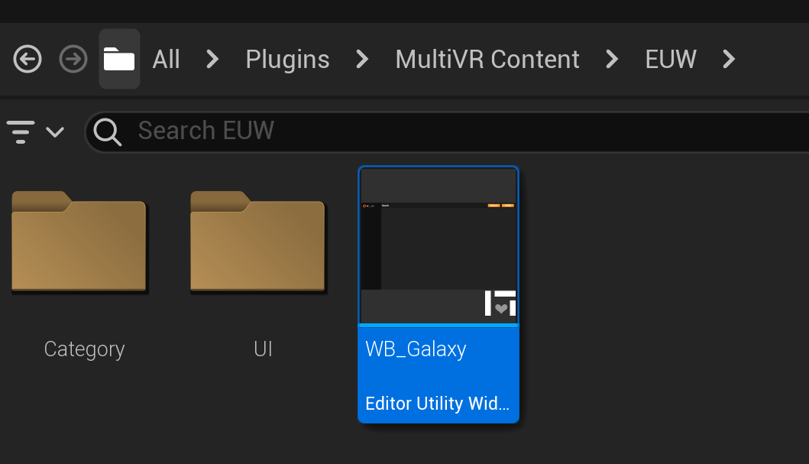 |  |
| Content Browser → Plugins → MultiVR Content → EUW → **WB_Galaxy**。 | 右鍵選 **Run Editor Utility Widget**，登入後選擇模型。匯入結果位於 `Content/GalaxyImport/<模型名稱>`。 |

## Log 說明

以 `adb logcat | findstr <關鍵字>` 查看。`Plugin Log Level` 設為 0 時以下 log 都不會印（`[PERFCTRL]` 除外）。

| 關鍵字 | 內容 |
|--------|------|
| `[PERFCTRL]` | 每次呼叫 `ApplyPerfSettings` 時印出完整設定 |
| `[first-init]` | 首次定位前每秒一行：收到幾幀、各被哪一關擋下（無 marker / 地板 / 雙眼不一致 / 未站定）；鎖定時印「鎖定完成，耗時 X 秒」 |
| `[SURVEY-MK]` / `[SURVEY-FIX]` / `[SURVEY-POS]` | 定位品質巡檢用：每顆 marker 的偵測結果、每次定位的校正量、每秒頭部位置 |
| `[NETLAT]` | 每 10 秒印網路往返與伺服器停留時間（平均 / P95） |
| `[STEREOPERF]` / `[SLAMPERF]` | 每秒定位處理次數與耗時（Log Level 2 才印） |

---

## 疑難排解

| 症狀 | 可能原因 / 處理 |
|------|-----------------|
| 開專案時說 MultiVR 模組遺失、要求重新編譯 | 引擎 BuildId 不是交付包指定的值。檢查安裝步驟 1，再做一次步驟 6（兩行都要跑） |
| 打包時 `Missing precompiled manifest` | 安裝步驟 4 沒做，或 `Plugins\MultiVR\Intermediate` 被刪除 |
| Server 連結時 `LNK2011` / `LNK1120` | 使用了舊版交付包，請改用最新版 |
| 引擎版本與交付包不符 | 每個交付包只能用於對應的引擎版本（5.3.2 / 5.8.4），請索取對應版本 |
| 裝置一啟動就閃退，log 有 `UnsatisfiedLinkError: libomp.so` | `libomp.so` 未打包，確認 `Plugins\MultiVR\Library` 完整並重新打包 |
| `calibration not exist` / `aruco map not exist` | 後台沒有該 `deviceType` 的標定檔或該 `MapName` 的地圖，向後台確認代號 |
| 開場定位很久才完成 | 看 `[first-init]` log：「無 marker」或「地板」多 → 請正對牆面 marker；「未站定」多 → 請站穩；「雙眼不一致」多 → 靠近 marker 一點再試 |
| 走動時位置校正變慢 | `Slam Interval` 設太大，調小或設回 0 |
| 編輯器裡按 Play 一直等不到 `OnSystemReady` | 正常：相機只在頭盔上開，定位要打包上頭盔測（見[頭盔驗證](#在頭盔上啟動與驗證)） |
| 建置時找不到 `OculusXR` / `MultiVRMetaModule` 相關符號 | 專案沒放入或沒啟用 Meta XR 插件（安裝步驟 5） |
| 頭盔 `open` content server 後連不上（`contentServer = failed`） | 執行 server 的電腦防火牆要開放 UDP 7777；確認 `-serverip` 是電腦的區網 IP |
| 收不到 `proximity_update` | 確認 UDP 7000 未被防火牆阻擋，且首次定位已完成 |
| HTC 裝置定位無效 | HTC 走 LBS 模式，`StartSystem` 的 `IsHTCLBS` 必須為 `true`，此模式不執行 Aruco SLAM |
