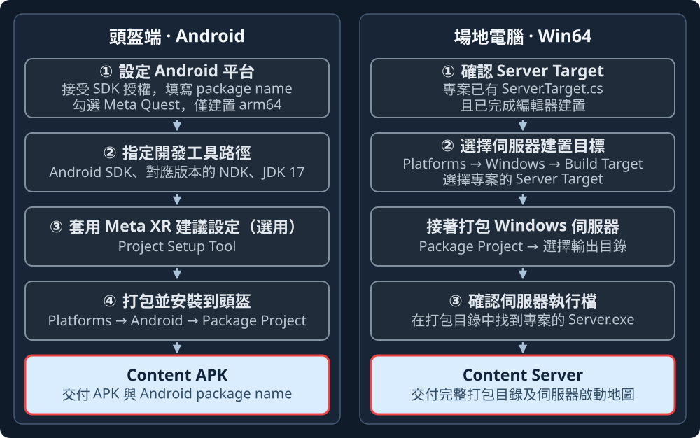

# 打包與場地驗收

[← 返回文件首頁](../../README.md#目錄)

## Android 打包注意事項

### 打包步驟

左欄是裝在頭盔上的 Android APK，右欄是由場館後台啟動的 Win64 Content Server。各欄由上往下閱讀，編號對應下方操作步驟。兩端打包完成後，依[場地驗收](#場地驗收)一起測試。

**頭盔 APK**

1. `Edit → Project Settings → Platforms → Android`：
   - 按 **Configure Now** 接受 SDK 授權；
   - 填 **Android Package Name**（例如 `com.YourCompany.example`）。**這個名稱要告訴系統方**，後台要用它讓 Lobby 啟動開發者交付的遊戲 APK（`connectData.packageName`）；
   - Package for Meta Quest devices 勾選；Build 只勾 arm64。
2. `Edit → Project Settings → Platforms → Android SDK`：填 SDK、NDK（版本見下方）、JDK 17 路徑。
3. Meta XR 建議設定可用 Meta XR 插件的 **Project Setup Tool**（工具列 Meta XR 選單）一鍵套用。
4. 工具列 `Platforms → Android → Package Project`，選輸出資料夾。完成後用資料夾內的 `Install_*.bat` 或 `adb install -r <apk>` 裝到頭盔。

**Content Server（Win64）**

1. 確認已有 `<專案>Server.Target.cs`（安裝步驟 4），並跑過一次步驟 6 的編輯器建置。
2. 工具列 `Platforms → Windows`：**Build Target** 選 `<專案>Server` → `Package Project`。
3. 輸出資料夾裡的 `<專案>Server.exe` 交給系統方，由後台啟動（啟動參數見 [Content Server 端](multiplayer.md#content-server-的-gamemode)）。

### 插件自動處理的部分

打包時插件會自動加入以下設定，**不需要手動加**：

- Android 權限：`CAMERA`、`horizonos.permission.HEADSET_CAMERA`、`RECORD_AUDIO`、`MANAGE_EXTERNAL_STORAGE`
- 頭盔相機存取與 WebRTC 串流需要的函式庫

其他：

- 只支援 **arm64-v8a**，Texture 格式建議 ASTC。
- NDK 版本依引擎：UE 5.3.2 用 r25b、UE 5.8.4 用 r27c。
- 執行期會先請求 Android 權限，權限未過前連線會先擱置，取得後自動續連。
- 標定檔與地圖檔每次啟動時由插件自動從後台下載，不需要放進專案。
- 若用 `-CookAll` 打包，可在 `DefaultGame.ini` 的 `[/Script/UnrealEd.ProjectPackagingSettings]` 加入 `+DirectoriesToNeverCook=(Path="/MultiVR/EUW")`，排除編輯器工具 Widget。

---

## 場地驗收

交付頭盔 APK、Android package name、Win64 Server 打包目錄及伺服器啟動地圖。與系統方用同一房間、兩台頭盔依序走一次下表。

| 現場操作 | 成功時看得到什麼 | 若卡住，先查 |
|---|---|---|
| 建立房間並選擇兩台頭盔 | Content Server 啟動，兩台 Lobby 各自開啟指定 APK | Server 的地圖與區網 IP、APK 的 package name |
| 等待玩家進入多人關卡 | 後台收到兩台頭盔的 `contentServer = connected` | `-serverip` 是否包含遊戲連接埠、UDP 7777 是否可達 |
| 讓兩位玩家各自面向牆面 marker 站穩 | 兩端都觸發 `OnSystemReady`，場景方向與實體場地一致 | `MapName`、標定檔與 `[first-init]` log |
| 讓兩位玩家靠近並移動 | `OnDetectNearbyUsers` 回傳對方位置，遊戲的角色或提示跟著移動 | 事件綁定、房間代號與 UDP 7000 |
| 從操作頁面開始、暫停，再結束遊戲 | Server 收到開始與暫停事件，兩台 Content 結束後回到 Lobby | GameMode 的事件綁定、Pawn 的 `WSMessage_CloseGame → Quit Game` |

[← 返回文件首頁](../../README.md#目錄)
