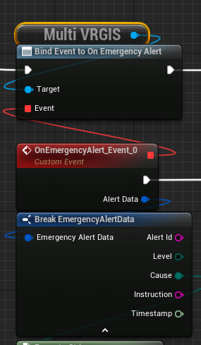
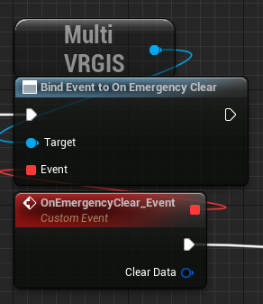
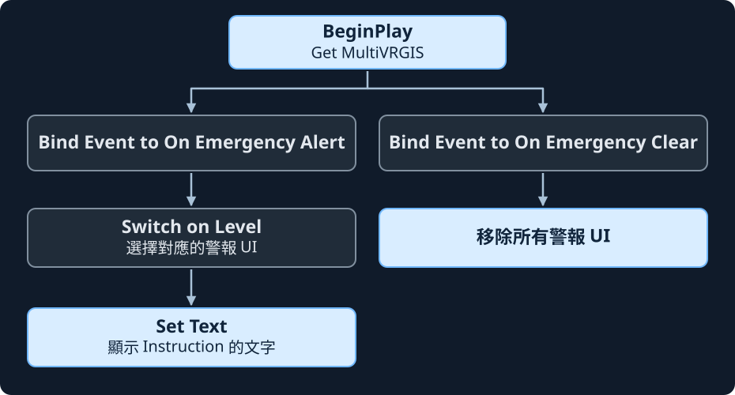

# 事件（Event Dispatcher）

[← 返回文件首頁](../../README.md#目錄)

### 通用

| 事件 | 參數 | 觸發時機 |
|------|------|----------|
| `WSOnConnected` | — | WebSocket 連線成功 |
| `WSOnReConnected` | — | 斷線後重連成功 |
| `WSOnConnectClose` | — | 連線關閉 |
| `WSOnConnectError` | `Message` | 連線錯誤（會自動重試） |
| `WSOnMessage` | `Message` | 收到任何原始訊息（除錯 / 自訂協定用） |
| `WSMessage_CloseGame` | — | 後台要求關閉遊戲 |

### Lobby（頭盔端）

| 事件 | 參數 |
|------|------|
| `WSMessage_StartGame` | `roomid, execPath, ip, port`：舊流程用（Lobby 也使用本插件時）。目前 Lobby 是獨立 App，Content 改由命令列取得參數，見 [Lobby → Content 流程](multiplayer.md#multiplayer) |

### Content（頭盔端）

| 事件 | 參數 | 說明 |
|------|------|------|
| `OnSystemReady` | — | 首次定位完成、UDP 啟動，可開始遊戲 |
| `OnDetectNearbyUsers` | `TArray<FUser>` | 鄰近玩家（`Clientid` / `Position` / `Rotation` / `IsSameRoom`），已換算到 Aruco 中心座標系 |
| `OnCameraBlock` | — | 相機被遮蔽（SLAM 回傳 `block`） |
| `OnHMDLanguageSet` | `Language` | 後台下發語系 |
| `OnTemperatureGet` | `Temperature` | 場館氣溫 |
| `OnEmergencyAlert` | `FEmergencyAlertData` | 緊急警報（`AlertId` / `Level` / `Cause` / `Instruction` / `Timestamp`），已自動回 ack |
| `OnEmergencyClear` | `FEmergencyClearData` | 解除警報（`AlertId` / `ResumedRooms` / `Timestamp`），UI 應清除所有警報 |
| `OnUpdateEyeTracking` | `GazeData, StereoGazeData, IsSuccess` | Meta 眼動 |
| `OnUpdateFaceTracking` | `FaceState, IsSuccess` | Meta 表情（70 組 blendshape 權重） |

`EEmergencyLevel`：`NOTICE / WARNING / CRITICAL`
`EEmergencyCause`：`CUSTOM / FIRE / EARTHQUAKE / EVACUATION`

| 發出警報 | 解除警報 |
|---|---|
|  |  |
| 從 Alert Data 取出 Level 與 Instruction。 | 收到事件時清除警報 UI。 |

#### 緊急警報 UI 建議

| Level | 建議 UI |
|-------|---------|
| `CRITICAL` | 全螢幕強制遮罩 + 音效，玩家無法關閉 |
| `WARNING` | 警告 UI 覆蓋，遊戲暫停 |
| `NOTICE` | 角落通知，不中斷遊戲 |

- 顯示文字一律用 `Instruction`（後台已組好、含多語系），`Cause` 只用來決定圖示或音效。
- 收到 `OnEmergencyClear` 時**一律清除所有警報 UI**，`AlertId` 可能是空字串（強制清除），不需判斷。
- ack 已內建（收到 `emergency_alert` 立即回 `emergency_alert_ack`），content 不用處理。

### GameServer（Dedicated Server）

| 事件 | 說明 |
|------|------|
| `OnWebAction_StartGame` | 後台按下「開始遊戲」 |
| `OnWebAction_PauseGame` | 後台按下「暫停遊戲」 |

[← 返回文件首頁](../../README.md#目錄)
