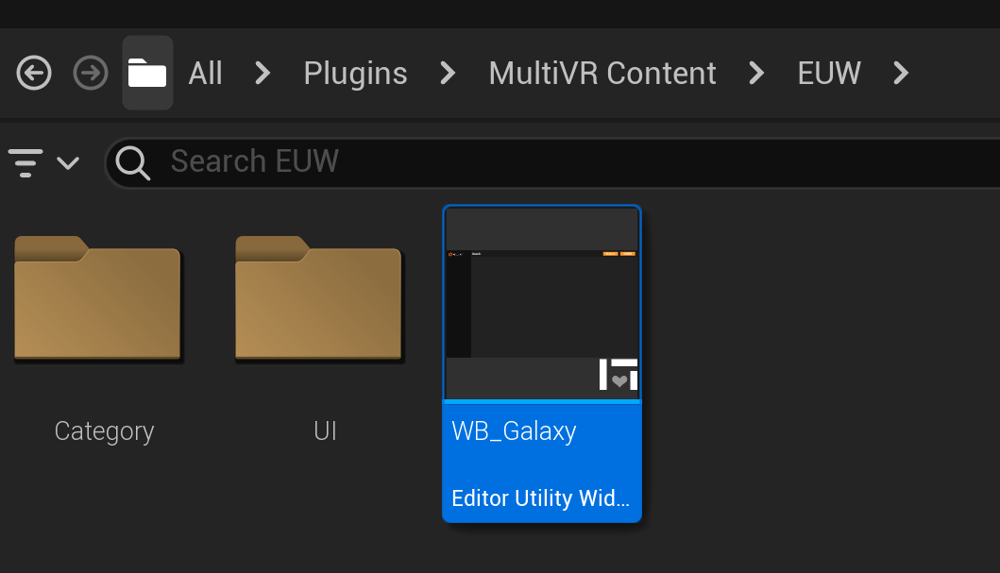
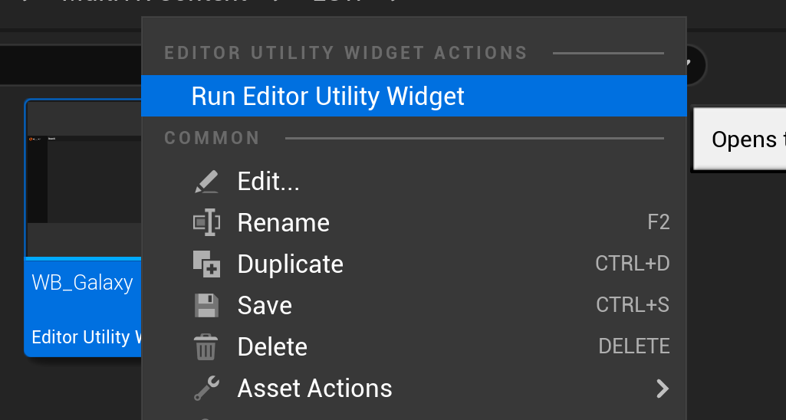

# Galaxy 素材庫

[← 返回文件首頁](../../README.md#目錄)

在 UE 編輯器開啟素材庫後，可依類別或名稱找模型，下載後透過 Unreal Importer 匯入專案。

*Galaxy 共用模型與場景組合示意。圖片取自 [FreeRoam Studio 官方產品頁](https://freeroam.moonshine.tw/zh-tw/studio/)。*

| ① 找到 Widget | ② 開啟素材庫 |
|---|---|
|  |  |
| Content Browser → Plugins → MultiVR Content → EUW → **WB_Galaxy**。 | 右鍵選 **Run Editor Utility Widget**，登入後選擇模型。匯入結果位於 `Content/GalaxyImport/<模型名稱>`。 |

[← 返回文件首頁](../../README.md#目錄)
