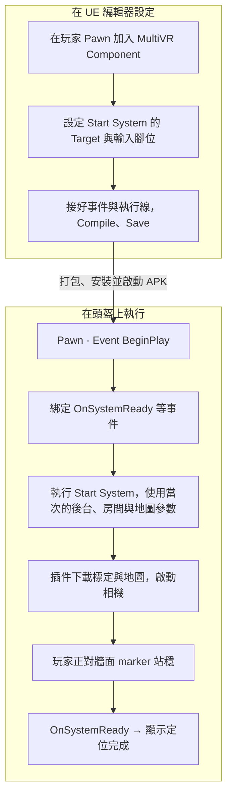
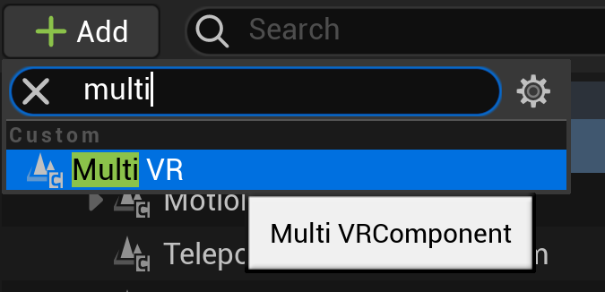
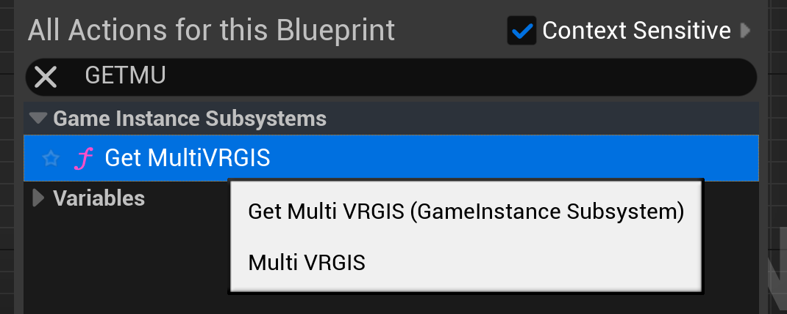
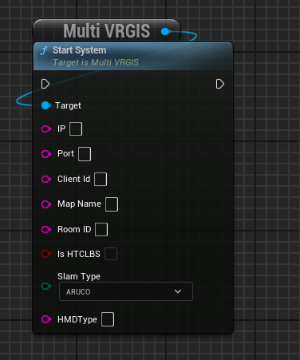
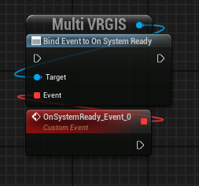
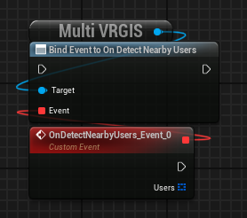
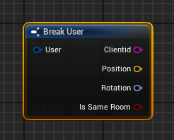

# 頭盔端整合

[← 返回文件首頁](../../README.md#目錄)

## 範例專案對照

若已從系統方取得 UE 5.8 的 **example 專案**，在 Unreal Editor 的 Content Browser 搜尋下列資產名稱，開啟 Blueprint 對照自己的專案。建議照實際整合進度分三次看。

| 什麼時候看 | 打開哪個 Blueprint | 看哪一段、怎麼用 |
|---|---|---|
| 插件已載入，要讓第一台頭盔定位時 | `BP_XRPawn` | 看 Components 面板與 Event Graph。對照自己的玩家 Pawn，先接就緒事件，再呼叫 `StartSystem` |
| 單台定位成功，要讓 Lobby 啟動多人遊戲時 | `BFL_GetArg`、`BP_XRPawn` | 看函式如何取出命令列參數，再看 Pawn 如何分流到 `open` 或 `StartSystem`。測試時改用自己的房間、地圖與連線位址 |
| 打包 Win64 Server、準備測開始與暫停時 | `BP_XRGameMode` | 看 Dedicated Server 判斷、事件綁定及 `StartConnectWebSocket`，對照自己的 GameMode 回報進度與狀態的時機 |

若尚未取得範例，可直接跟著下一節的流程圖與節點截圖接線。

## 快速開始

先用單台 Quest 驗證 ArUco 定位。先在編輯器接好 Blueprint，再打包到頭盔驗證。下圖以上下兩段標出設定與執行的時機。



### 1. 在 VR Pawn 上加入元件

打開玩家的 VR Pawn 藍圖（含 Camera 元件的 Pawn，例如 VR Template 的 `VRPawn`）→ 左上 **Components** 面板按 **Add** → 搜尋「MultiVR」→ 選 **MultiVR Component** → Compile、Save。
不需要設定任何屬性：元件會在第一次定位成功時自動抓取 Camera，並把 Pawn 設為 Aruco 中心 Actor。

> 確認這個 Pawn 就是遊戲實際會生成的 Pawn（GameMode 的 `Default Pawn Class`，或關卡中設為 `Auto Possess Player = Player 0` 的 Pawn）。

| 在 Components 面板新增元件 | 在 Event Graph 取得插件入口 |
|---|---|
|  |  |
| 加到實際生成的玩家 Pawn。 | 取出的 MultiVRGIS 接到事件與函式的 Target。 |

### 2. 設定 Start System 節點

在 Pawn 的 Event Graph 放入 `Get MultiVRGIS`，從輸出腳位拉出 **Start System**。先設定下圖的輸入腳位，執行線在下一步接上。



單台頭盔測試可直接填入場館的後台 IP、Port、房間與地圖代號，並省略 UE 遊戲伺服器的 `-serverip`。正式多人開場時，在編輯器把這些腳位接到變數；遊戲啟動後從 Lobby 傳入的命令列取得當次的值，再執行節點。

```
StartSystem(
    IP        = "192.168.9.223",   // 後台電腦的 IP（正式流程由 Lobby 傳入 -wsserverip）
    Port      = "5000",            // 後台的 port（-wsport）
    ClientId  = "",                // 留空：自動用頭盔的 Wi-Fi IP 當頭盔 ID（建議一律留空）
    MapName   = "MapCodeName",     // 場地地圖的代號，要跟後台存的一樣（-mapName）
    RoomID    = "1234",            // 房間代號（-roomId）
    IsHTCLBS  = false,             // Quest 一律 false；true 只用於 HTC LBS 裝置
    SlamType  = ARUCO,             // 用 marker 定位填 ARUCO（MARKLESS / MIX 為無 marker 定位）
    HMDType   = "quest3s"          // 目前不使用（標定檔固定以 quest3s 向後台索取），填 "quest3s" 即可
)
```

### 3. 接好事件與啟動執行線

在玩家 Pawn 的 BeginPlay、**呼叫 `StartSystem` 之前**綁定。藍圖做法：`Get MultiVRGIS` 拉出線 → 搜尋 **Bind Event to On System Ready** → 從節點左邊紅色的 `Event` 腳位拉出 → `Add Custom Event`，由開發者在 Custom Event 後接上定位完成時要執行的遊戲邏輯。其他事件做法相同。

**接線時對照**：下圖由左到右是首次定位、附近玩家事件，以及拆開一筆玩家資料的節點。

| 首次定位完成 | 收到附近玩家 | 讀取一筆玩家資料 |
|---|---|---|
|  |  |  |
| 接自訂事件顯示就緒畫面。 | 遍歷 Users 陣列。 | 用 Clientid 找角色，用 Position 與 Rotation 更新姿態。 |

至少綁定以下事件：

| 事件 | 什麼時候發生 | 開發者的處理方式 |
|------|--------------|----------------|
| `OnSystemReady` | 首次定位完成 | 顯示開始畫面、允許玩家開始遊戲 |
| `OnDetectNearbyUsers` | 收到其他玩家的位置（持續觸發） | 用 `Clientid` 生成 / 移動其他玩家的角色 |
| `WSMessage_CloseGame` | 工作人員結束遊戲 | `Quit Game`，頭盔會回到 Lobby |
| `OnEmergencyAlert` / `OnEmergencyClear` | 工作人員發出 / 解除緊急警報 | 顯示 / 清除警報畫面（見[緊急警報 UI 建議](events.md#緊急警報-ui-建議)） |
| `OnCameraBlock` | 頭盔相機被遮住 | 提示玩家不要遮住頭盔前方 |

在 Event Graph 將白色執行線依序接成 **Event BeginPlay → Bind Event 節點 → Start System**。將 `OnSystemReady` 對應的 Custom Event 接到「定位完成」畫面提示，再 Compile、Save。

#### 在頭盔上啟動與驗證

呼叫之後插件會自動做完以下所有事，不需要另外寫程式：連上後台 → 下載相機標定檔 → 下載地圖 → 打開相機開始定位 → 首次定位完成後發出 `OnSystemReady`。

> **定位只能在頭盔上測試**：在編輯器（PIE）或 Win64 執行時，插件仍會連後台、下載地圖，但不會開相機，所以**不會有 `OnSystemReady`**。編輯器裡適合測連線與畫面，定位請打包 APK 上頭盔測。

**上機驗證**：依[打包步驟](delivery.md#android-打包注意事項)安裝 APK，在測試房間啟動遊戲。戴好頭盔正對牆面 marker 站穩 1～2 秒。畫面出現「定位完成」即代表收到 `OnSystemReady`。若只看到連線成功，仍需等首次定位事件；可用 [Log 說明](troubleshooting.md#log-說明) 的 `[first-init]` 查看卡在哪個條件。

[← 返回文件首頁](../../README.md#目錄)
