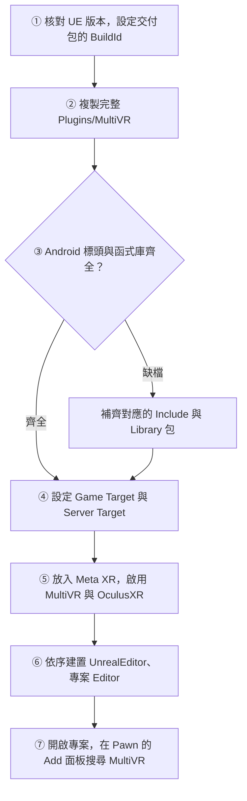

# 環境與安裝

[← 返回文件首頁](../../README.md#目錄)

## 環境需求

| 項目 | 需求 |
|------|------|
| Unreal Engine | **原始碼版** UE 5.3.2 或 UE 5.8.4（不支援 Epic Launcher 版）。交付包分版本提供，請使用與引擎相同版本的包 |
| 引擎 BuildId | 引擎的 `Engine\Build\Build.version` 必須加上交付包指定的 BuildId（見[安裝步驟](#安裝步驟)） |
| 專案 | **C++ 專案**（純藍圖專案先在編輯器 `Tools → New C++ Class` 隨便加一個 class 就會變成 C++ 專案）；打包 content server 需要 Server Target（`<專案>Server.Target.cs`，見安裝步驟 4） |
| 目標平台 | Android（arm64-v8a）為主，Win64 可在編輯器內開發；content server 只支援 Win64 |
| HMD | Meta Quest 3 / 3S / Quest Pro；HTC 裝置走 LBS 模式（`IsHTCLBS`） |
| 相依插件 | **Meta XR 插件（`OculusXR`）必須放在專案的 `Plugins` 並啟用**（與引擎版本對應的版本）；`AndroidPermission` 由 MultiVR 自動啟用 |
| Android | SDK、JDK 17；NDK 版本依引擎：**UE 5.3.2 用 r25b、UE 5.8.4 用 r27c** |

---

## 安裝步驟

> **使用 AI Agent 協助安裝**
>
> 插件交付包內附 `Plugins/MultiVR/AGENT_INSTALL.md`。使用 AI Agent 協作的開發者，可將這份文件交給 Agent，並提供目標 UE 專案與引擎的路徑，請 Agent 依該版本的指引協助安裝插件及設定專案。

### 安裝流程一覽



圖中的編號對應下方七個操作步驟。完整 zip 若已包含 Android 相依檔，核對完第 3 步即可繼續。

開始前，向系統方確認交付包版本與 BuildId。上頭盔測試前，另備妥可連線的後台 IP、連接埠、測試房間代號、場地地圖代號，以及與地圖相符的牆面 marker。

1. **設定引擎 BuildId**
   打開 `<引擎>\Engine\Build\Build.version`，在最後一個欄位後面加上一行（前一行要補逗號）：

   ```json
   {
     "MajorVersion": 5,
     ...（原本的欄位不動）...
     "BranchName": "++UE5+Release-5.x",
     "BuildId": "<交付包 README 內的 BuildId>"
   }
   ```

   每台要開這個專案的電腦都要做。插件只能在 BuildId 相同的引擎上載入，沒設定的話開專案會出現「模組遺失」並要求重新編譯。

2. **放入外掛**
   把交付包裡整個 `Plugins/MultiVR` 資料夾複製到 `<專案>\Plugins\MultiVR`。已有舊版時，先整個刪除再放入，不要混用新舊檔案。

3. **補上 markerless 相依檔（依交付包內容）**
   RTAB-Map / PCL / Boost 的標頭與函式庫太大（約 3.2 GB），若交付包缺少下列檔案，請另外下載。**沒補上的話 Android 打包會失敗**。

   1. 下載 Include 包：https://drive.google.com/file/d/1QTqyZEEMALUr-rLC0KLCdpFL1AuSgw1J/view?usp=sharing
      解壓到 `<專案>\Plugins\MultiVR\Include\Android\include`
   2. 下載 Library 包：https://drive.google.com/file/d/1sBz7Is1bqi5pGB7Mha1HX-KHheI1jMv8/view?usp=sharing
      解壓到 `<專案>\Plugins\MultiVR\Library\Android\libs` 並覆蓋

   完成後應該有 `Include\Android\include\rtabmap`、`pcl`、`boost` 三個資料夾，以及 `Library\Android\libs\arm64-v8a\librtabmap_core.a`。
   （若拿到的是系統方直接給的完整 zip，裡面已經包含，這步可略過。）

4. **修改 Target**
   在專案的 Game Target（`<專案>.Target.cs`）與 Server Target（`<專案>Server.Target.cs`）建構式內都加上：

   ```csharp
   BuildEnvironment = TargetBuildEnvironment.Shared;
   ```

   沒加的話，打包 APK 或 content server 時會出現 `Missing precompiled manifest`。

   專案還沒有 Server Target 時，複製 `Source\<專案>.Target.cs` 成 `Source\<專案>Server.Target.cs`，把裡面的 class 名稱改成 `<專案>ServerTarget`、`Type = TargetType.Game` 改成 `Type = TargetType.Server`。

5. **在 `.uproject` 啟用插件**（`MultiVR` 與 `OculusXR` 都**必須**啟用，沒啟用 OculusXR 會建置失敗）：

   ```json
   "Plugins": [
     { "Name": "MultiVR", "Enabled": true },
     { "Name": "OculusXR", "Enabled": true }
   ]
   ```

   Meta XR 插件本身要另外放進 `<專案>\Plugins\MetaXR`（使用與引擎版本對應的版本）。

6. **建置一次編輯器**
   依序執行（先引擎、再專案；只建專案的話，引擎的 BuildId 不會更新）：

   ```
   <引擎>\Engine\Build\BatchFiles\Build.bat UnrealEditor Win64 Development -WaitMutex
   <引擎>\Engine\Build\BatchFiles\Build.bat <專案>Editor Win64 Development -Project="<專案>.uproject" -WaitMutex
   ```

   第一行通常只會更新清單檔，約數十秒。完成後 `<引擎>\Engine\Binaries\Win64\UnrealEditor.modules` 的 BuildId 應該等於交付包的值。

7. **開啟專案**，確認沒有出現「模組遺失或由不同引擎版本建置」的對話框。

### 不要做的事

- **不要刪除 `Plugins\MultiVR\Intermediate` 和 `Plugins\MultiVR\Binaries`**：插件打包要用到裡面的檔案，刪了就無法打包。清理專案時只刪專案自己的 `Intermediate`、`Binaries`。
- 不要對 MultiVR 執行 Rebuild，也不要在出現「是否重新編譯 MultiVR」時按「是」：插件是建置好的，重新編譯一定失敗。出現這個對話框代表 BuildId 沒設對，回頭檢查步驟 1 和步驟 6。
- 不要手動修改 `Plugins\MultiVR\Binaries\Win64\UnrealEditor.modules`。
- 不要用其他來源的 OpenCV / RTAB-Map / PCL / Boost 替換 `Include` / `Library`：只用交付包內附的檔案與上面兩個下載包，版本不符會連結錯誤或閃退。

---

## 目錄結構

```
Plugins/MultiVR/
├─ MultiVR.uplugin
├─ README.md                      本版本的安裝說明（含 BuildId）
├─ AGENT_INSTALL.md               供 AI Agent 協助安裝插件與設定 UE 專案的指引
├─ Binaries/ , Intermediate/      建置好的插件檔案（不可刪、不可改）
├─ Content/                       插件附帶的素材與編輯器工具（Galaxy 素材庫）
├─ Include/ , Library/            插件需要的函式庫（RTAB-Map / PCL / Boost 依包內檔案確認，見安裝步驟 3）
└─ Source/                        給專案引用的標頭檔（不需要修改）
```

整個資料夾照原樣放進專案即可，裡面的檔案都不需要手動修改。

開發者在 Blueprint 中會用到以下兩個插件入口：

| 名稱 | 在哪裡用 | 負責 |
|------|----------|------|
| **Multi VRGIS** | 任何藍圖搜尋「Multi VRGIS」取得 | 連線後台、定位、收發訊息、效能設定，所有函式與事件都在這裡 |
| **MultiVR Component** | 加在玩家 Pawn 上 | 把定位結果套用到玩家位置，並自動處理靠牆透視、眼動 / 表情追蹤 |

[← 返回文件首頁](../../README.md#目錄)
