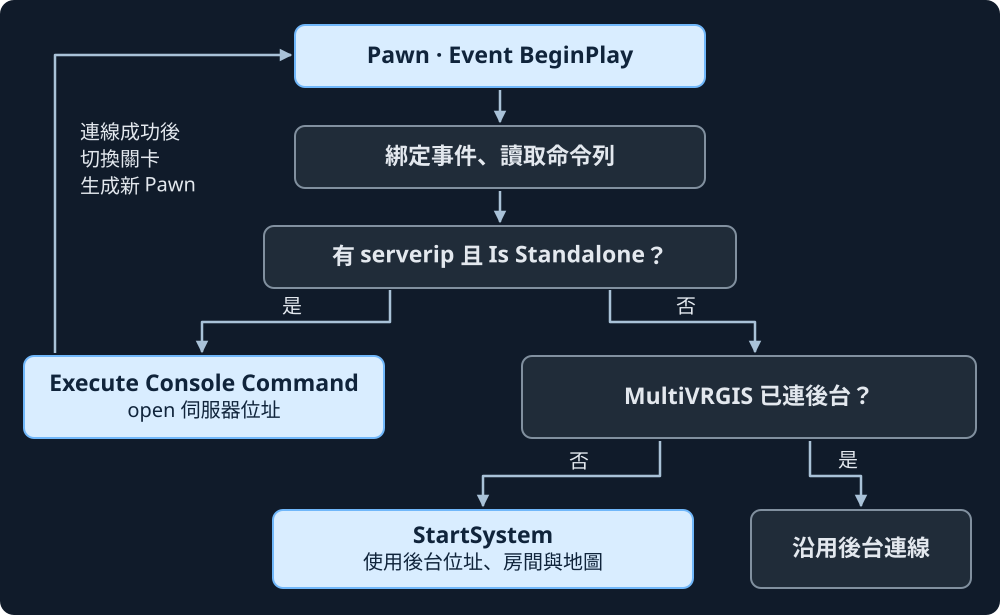
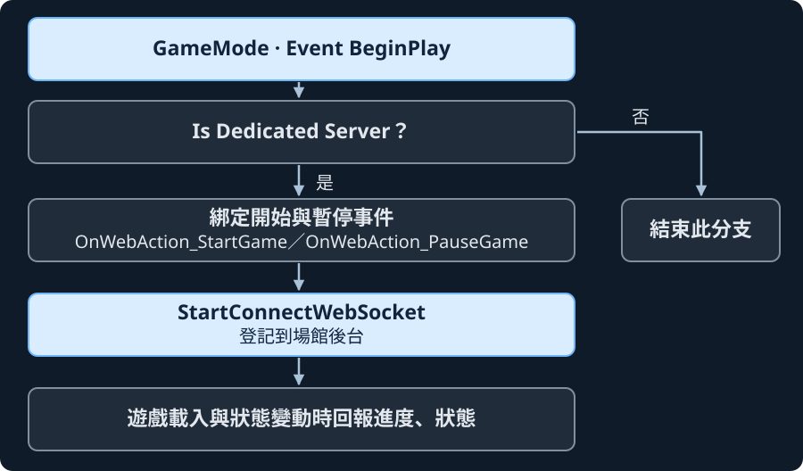
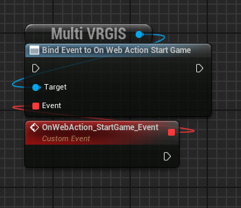
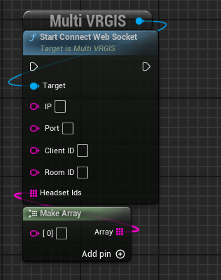

# 多人開場與遊戲伺服器

[← 返回文件首頁](../../README.md#目錄)

<a id="multiplayer"></a>

## Lobby → Content 流程（多人遊戲）

正式開場時，Lobby 會帶入遊戲伺服器位址。下圖是 **Content 的 Pawn 藍圖**：第一次 BeginPlay 負責加入多人關卡；進入該關卡後，新 Pawn 的 BeginPlay 再啟動定位。

[](../images/multivr/multiplayer-pawn.svg)

1. 後台開始遊戲時，Lobby 收到 `headset_game_backend_command`（`command=connect`）：

   ```json
   {
     "type": "headset_game_backend_command",
     "command": "connect",
     "connectData": {
       "roomId": "room1",
       "ip": "192.168.9.102",
       "port": 7777,
       "packageName": "com.YourCompany.example",
       "mapName": "tt"
     }
   }
   ```

   Lobby 關閉自己的 WebSocket（讓出共用的 `clientId`），約 3 秒後用 Android Intent 啟動 `packageName` 指定的 Content APK，把參數組成 UE 命令列放進 Intent extra **`cmdline`**（必須全小寫）。效果等同下面這行 adb 指令：

   ```bat
   adb shell "am start -S -n com.YourCompany.example/com.epicgames.unreal.GameActivity --es cmdline '-wsserverip=192.168.9.102 -wsport=5000 -mapName=tt -roomId=room1 -serverip=192.168.9.102:7777'"
   ```

   | 參數 | 來源 | 用途 |
   |------|------|------|
   | `-serverip` | `connectData.ip` + `port` | content server 位址，Content 用 `open` 連進去 |
   | `-wsserverip` / `-wsport` | Lobby 連的後台位址 | `StartSystem` 的 IP / Port |
   | `-roomId` | `connectData.roomId` | `StartSystem` 的 RoomID |
   | `-mapName` | `connectData.mapName` | `StartSystem` 的 MapName（Aruco 地圖代號） |

   > **不經過 Lobby 測試**：content server 跑起來後，直接用上面的 adb 指令（換成自己的 package、IP、房間、地圖）就能模擬 Lobby 啟動遊戲。`-S` 會先關掉已在執行的 App 再重開。

2. **Content 啟動後由專案自行讀取這些參數**（插件不會自動解析）：Blueprint 用 `Get Command Line` → `Parse Command Line` 拆成 Key/Value（輸出的 `Params` Map），再用 `Find` 以 Key 找值；**Key 不含減號**，例如找 `serverip` 而不是 `-serverip`（C++ 可用 `FParse::Value(FCommandLine::Get(), TEXT("serverip="), Out)`）。沒帶參數時用預設值，方便單機測試。
3. **Pawn 的 BeginPlay**（每次進關卡都會跑）：先綁定 MultiVR 事件（`OnSystemReady`、`WSMessage_CloseGame` 等），再依情況二選一：
   - **有帶 `-serverip`，而且目前是單機（`Is Standalone`）** → 執行 Console Command `open <serverip>`，連進 content server。
   - **否則，如果插件還沒連線（`IsConnected()` = false）** → 呼叫 `StartSystem`：
     - `IP` / `Port` = `-wsserverip` / `-wsport`
     - `RoomID` = `-roomId`
     - `MapName` = `-mapName`
     - **`ClientId` 留空**：插件會用裝置 IPv4，與 Lobby 使用的身分相同，後台才對得上同一台頭盔。
4. `open` 會換關卡，**Pawn 重生、BeginPlay 再跑一次**。這時已經是 client（不是單機），所以改走 `StartSystem`。
   - 事件每次都要重新綁定；`StartSystem` 只會在第一次（`IsConnected()` = false）時呼叫。
   - 沒帶 `-serverip`（單機測試）時第一次就直接 `StartSystem`，留在目前關卡。
5. 插件自動完成標定、地圖、首次定位 → **`OnSystemReady`**，遊戲可以開始。
6. 插件會自動回報 content server 連線狀態（`headset_status.contentServer`）：
   - 進入 content server 的關卡 → `connected`
   - 連不上 → `failed`（附錯誤原因）
   - 連上後斷線，或回到單機關卡 → `disconnected`
7. 後台結束遊戲時，Content 收到 `headset_game_backend_command`（`command=disconnect`），插件自動回覆 `game_close` 並廣播 **`WSMessage_CloseGame`**。**請在這裡結束 App（`Quit Game`）**，Lobby 會回到前景並重新連線後台。

> Lobby 與 Content 在同一台頭盔共用同一個 IPv4 作為 `clientId`，同一時間只能有一方連著後台；Lobby 會在啟動 Content 前先斷線，Content 結束後再重連。Lobby 的細節（安裝、watchdog、kiosk 設定）見 Lobby 專案的 README。
>
> `WSMessage_StartGame` 是舊流程（Lobby 也用本插件時）使用的事件，目前的 Lobby App 架構下 Content 不需要綁定。

### Content Server 的 GameMode

[](../images/multivr/server-startup.svg)


| 先綁定操作頁面的開始事件 | 再登記伺服器連線 |
|---|---|
|  |  |
| 暫停事件用相同方式綁定 `OnWebAction_PauseGame`。 | 將命令列的房間代號與頭盔清單傳給後台。 |

- 啟動範例：`exampleServer.exe /Game/<地圖> -port=7777 -ip=<本機區網 IP> -wsserverip=<後台 IP> -wsport=5000 -roomId=<房間> -headsetIds=<逗號分隔>`。地圖要放第一個參數，否則會載入空的預設地圖。
- **`-ip` 不能空**：後台收到空 ip 會忽略這台 content server，房間綁不上，開始 / 暫停都沒反應。
- GameMode 的 BeginPlay（先用 `Is Dedicated Server` 接 Branch，只有 true 才往下做，避免頭盔或編輯器單機時也跑）：綁定事件後呼叫 `StartConnectWebSocket`（IP / Port / RoomID / HeadsetIds 由命令列帶入，`ClientID` 留空）。插件以 `game_backend` 身分連線，並把 ip / port 回報給後台。
- **房間要先建立，content server 才能啟動**。
- 用 `WSSend_Progress` 回報載入進度、`WSSend_GameStatus` 回報遊戲狀態。
- 綁定 `OnWebAction_StartGame` / `OnWebAction_PauseGame` 接收後台的開始 / 暫停。
- 後台送 `close_content_server` 時插件會直接結束程式。

### 選用的效能設定

需要省 CPU 或調整 log 時，呼叫 `ApplyPerfSettings`，見[效能設定](xr-performance.md#效能設定)。不呼叫則維持預設行為。

[← 返回文件首頁](../../README.md#目錄)
