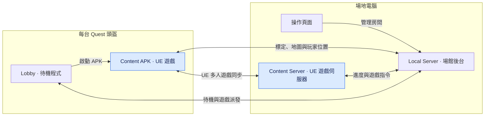
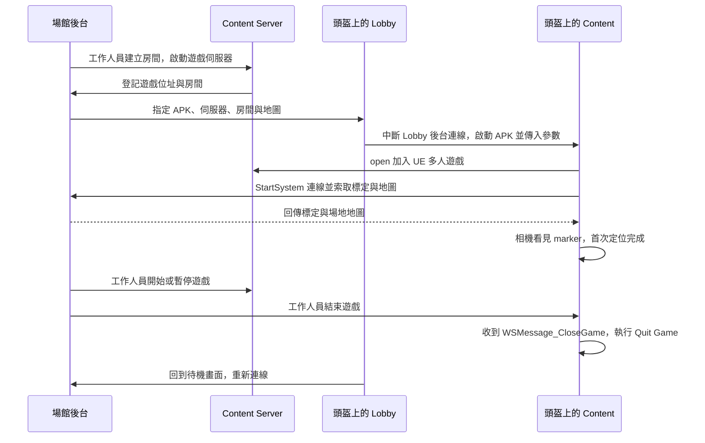

# 系統與整合流程

[← 返回文件首頁](../../README.md#目錄)

## 第一次整合，從這裡開始

| 階段 | 開發者的整合步驟 | 怎麼知道成功 |
|---|---|---|
| ① 認識系統 | [看懂頭盔的兩條連線](#先認識這個系統) | 知道哪個位址填入 `StartSystem`、哪個用來加入 UE 遊戲 |
| ② 載入插件 | [確認環境](installation.md#環境需求)，再[安裝預建包](installation.md#安裝步驟) | 編輯器開啟專案，Pawn 的 Components 面板能找到 MultiVR |
| ③ 定位一台頭盔 | [接好 Pawn 藍圖](headset.md#快速開始)，打包 APK，在場地看向牆面標記 | 自訂的 `OnSystemReady` 事件觸發 |
| ④ 接上多人開場 | [讀取 Lobby 參數、連入 Content Server](multiplayer.md#multiplayer) | 後台收到 `contentServer = connected`，伺服器可接收開始與暫停 |
| ⑤ 交付與驗收 | [打包兩端](delivery.md#android-打包注意事項)，再[走完一場遊戲](delivery.md#場地驗收) | 兩台頭盔各自取得對方位置，結束後回到 Lobby |

## 先認識這個系統

圖中藍色的兩個程式都透過 FreeRoam Studio 的 MultiVR Plugin 連到場館後台。頭盔上的 Content 負責定位與玩家互動，Win64 上的 Content Server 負責 UE 多人遊戲同步，並向後台回報遊戲狀態。

**頭盔上的 Content 會連到兩個服務。** 即使服務跑在同一台電腦，也要依用途把位址交給正確的藍圖節點。

| 要做的事 | 連到哪裡 | Content 怎麼連 |
|---|---|---|
| 取得地圖、標定與房間事件 | Local Server，WebSocket 預設 5000 | `StartSystem` 填入 `-wsserverip` 和 `-wsport`。插件另以 UDP 7000 上傳頭盔位置 |
| 加入同一場 UE 多人遊戲 | Content Server，遊戲連線預設 UDP 7777 | 讀取含連接埠的 `-serverip`，執行 `open <serverip>` |

**場地怎麼對齊？** 每個 ArUco marker 都有編號，系統方事先量好它的位置並存成場地地圖。遊戲帶入地圖代號（`MapName`），插件自動下載地圖和相機標定檔。玩家正對牆面 marker 站穩後，頭盔相機辨識標記，插件算出玩家在場地中的位置與朝向。以下首次定位範例採用這個 ArUco 流程。

### 一場遊戲怎麼開始與結束

## 執行時程式與功能

同一個 UE 專案會在頭盔和遊戲伺服器執行。接 Blueprint 時，先看功能發生在哪一端，再選該端的 Pawn 或 GameMode。

| 現場發生什麼事 | 正在執行的程式 | 哪段程式負責 | 開發者要接的功能 |
|---|---|---|---|
| 操作員選房間、地圖和頭盔 | 操作頁面 → Local Server | 後台啟動 Content Server，通知 Lobby | 提供 APK 的 package name 和 Server 啟動地圖 |
| 頭盔從待機畫面進入遊戲 | Lobby → Content APK | Lobby 用 Android Intent 帶入命令列，Content 的 Pawn 在 BeginPlay 讀取參數 | 讀取 `serverip`，在單機關卡用 `open` 加入伺服器 |
| 虛擬場景對齊場地 | Content APK | `MultiVRGIS.StartSystem` 取得地圖與標定；`MultiVR Component` 將定位結果套用到 Pawn | 先綁 `OnSystemReady`，首次定位完成後顯示就緒畫面 |
| 玩家走近彼此 | Content APK ↔ Local Server | 插件上傳位置，後台分送附近玩家資料 | 在 Pawn 接 `OnDetectNearbyUsers`，依玩家 ID、位置與朝向更新角色 |
| 操作員開始或暫停遊戲 | Local Server → Content Server | Dedicated Server 的 GameMode 透過 `StartConnectWebSocket` 接收指令 | 接 `OnWebAction_StartGame`／`OnWebAction_PauseGame`，以 `WSSend_GameStatus` 回報狀態 |
| 場館發出或解除警報 | Local Server → Content APK | 插件接收警報並自動回覆確認 | 接 `OnEmergencyAlert` 顯示指示，接 `OnEmergencyClear` 清除畫面 |
| 工作人員結束遊戲 | Local Server → Content APK → Lobby | Content 收到關閉指令，Lobby 在 Content 結束後回到前景 | 在 `WSMessage_CloseGame` 執行 `Quit Game` |

[← 返回文件首頁](../../README.md#目錄)
