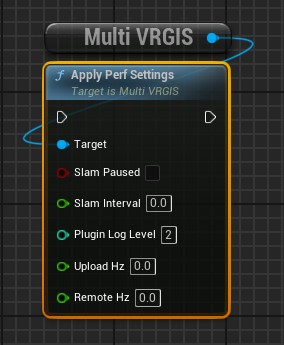
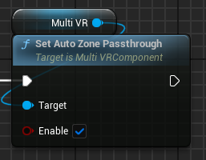

# 效能與 Meta XR

[← 返回文件首頁](../../README.md#目錄)

## 效能設定

藍圖節點 **Apply Perf Settings**（Target 接 `Multi VRGIS`）一次設定以下 5 個參數。全部使用預設值 = 原本的行為，**不呼叫也不影響任何功能**。

| 參數 | 預設 | 說明 |
|------|------|------|
| `Slam Paused` | 不勾 | 勾選 = 暫停定位，只靠頭盔自身追蹤（會逐漸漂移） |
| `Slam Interval` | 0 | 兩次定位之間最少間隔幾秒。0 = 不限（約每秒 13 次）。**建議 0.3～0.5**；實測 0.5 秒時 CPU 約從 89% 降到 62% |
| `Plugin Log Level` | 2 | 0 = 全關、1 = 重要（建議正式上線）、2 = 全部（含每秒效能診斷） |
| `Upload Hz` | 0 | 頭盔位置每秒最多上傳幾次。0 = 不限（原本每秒 20 次） |
| `Remote Hz` | 0 | 其他玩家位置每秒最多處理幾次。0 = 全部處理 |

調整單一參數時，也要填入其餘四個參數的預期值。

使用注意：

- **沒有呼叫順序的要求**：Start System 之前或之後、BeginPlay 或任何事件之後都可以，隨時呼叫立即生效。
- **每次呼叫都會設定全部 5 個值**，沒填的欄位會回到預設值。只想改其中一項時，其他欄位也要填回目前的值（可先用 **Get Perf Settings** 讀出）。
- 確認生效：logcat 會印 `[PERFCTRL] SlamPaused=… SlamInterval=…`。

---

## Meta XR 功能

首次定位完成時，**MultiVR Component** 會自動在 Pawn 上加入以下三個元件，不需要手動加：

| 元件 | 功能 |
|------|------|
| `UMultiVRMetaPassthroughComponent` | 依玩家與危險區（牆、柱）的距離動態調整 Passthrough 透明度：距邊界 40 cm 開始漸變，10 cm 內完全透視。可用 `SetAutoZonePassthrough(false)` 關閉 |
| `UMultiVRMetaEyeTrackingComponent` | 每幀取 Gaze / StereoGaze → `OnUpdateEyeTracking` |
| `UMultiVRMetaFaceTrackingComponent` | 每幀取 70 組表情權重 → `OnUpdateFaceTracking` |

`UMultiVRMetaXRMovementFuncLib::IsSupportEyeTracking() / IsSupportFaceTracking()` 可先行檢查裝置支援度。

---

在玩家 Pawn 的 **MultiVR Component** 上呼叫此節點，可切換靠近場地邊界時的自動透視。

[← 返回文件首頁](../../README.md#目錄)
